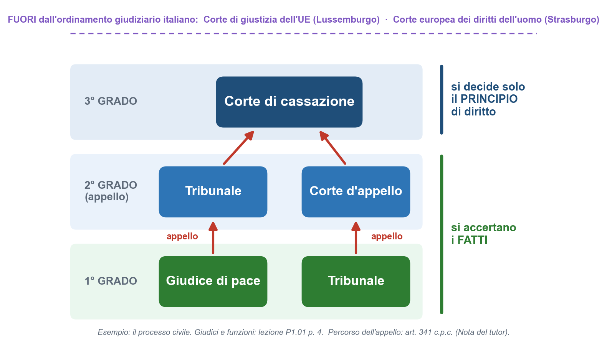

# Cap. 1 — Concetti fondamentali del diritto

Fonti: [P1.01 pp. 1–5] · la p. 5 fino al riepilogo sulle norme derogabili; il resto della p. 5 è nel Cap. 2 · definizioni, schema e domande d'esame sono nel file di ripasso

> **Dove siamo** — Tappa I, *Le basi del diritto*, primo capitolo. Qui ci sono **le parole base** che il professore userà in tutto il corso: per comprendere il diritto dell'impresa «è necessario familiarizzare con alcuni concetti e termini giuridici fondamentali» [P1.01 p. 1].
>
> **Che cosa prepara:** il Cap. 2 usa subito questi concetti per distinguere la regola valida per tutti (*diritto oggettivo*) dal potere che la regola dà a ciascuno (*diritto soggettivo*).

## 1.1 L'ordinamento giuridico e chi crea le regole

> **Filo rosso** —
>
> **Cosa vediamo:** che cos'è l'ordinamento giuridico, chi crea le regole, per chi valgono e che posto ha il diritto europeo.
>
> **Perché ci serve:** ogni regola del corso fa parte di un ordinamento ed è stata creata da qualcuno.
>
> **Perché è qui:** è l'inizio della prima lezione; nel par. 1.2 vedremo come le regole si applicano ai fatti.

> **Parole nuove** — **Ordinamento giuridico** = tutte le regole di una società, messe insieme. **Legislatore** = chi fa le regole. **Funzione normativa** = l'attività di creare regole (le *norme*). **Sovranazionale** = che sta "sopra" i singoli Stati: qui, l'Unione europea. **Direttiva** = regola europea che ogni Stato deve inserire nelle proprie leggi, con un margine di scelta. **Recepire** = inserire una direttiva nelle leggi nazionali.

> **Definizione** — L'**ordinamento giuridico** è l'insieme delle regole che disciplinano la vita della società [P1.01 p. 1].

> **Spiegazione del tutor** — Le regole sul traffico, sui contratti, sulle tasse, sul matrimonio, sui reati: messe tutte insieme formano l'ordinamento giuridico. «Disciplinare» vuol dire «dare regole».

Le regole vengono dettate dal **legislatore**, che nel nostro ordinamento è rappresentato principalmente dal **Parlamento** e dal **Governo**: organi dello Stato che, in base alle loro competenze, svolgono la **funzione normativa** [P1.01 p. 1]. → Come si dividono il lavoro: Cap. 3, par. 3.5 e 3.8.

> **Definizione** — Il **diritto interno** è il diritto dello Stato italiano, che si applica sul territorio italiano. È soprattutto questo il diritto che studiamo [P1.01 p. 1].

==Il diritto italiano si applica a chiunque si trovi in Italia: non soltanto ai cittadini italiani, ma anche agli stranieri che entrano nel territorio italiano e vi soggiornano, anche per un periodo breve== [P1.01 p. 1].

> **Esempio aggiuntivo (tutor)** — Hans, turista tedesco, passa una settimana a Rimini con un'auto a noleggio. Anche se resta solo sette giorni, deve rispettare le regole italiane, per esempio quelle sulla circolazione stradale [P1.01 p. 1].

> **Nota del tutor (fuori dalle lezioni)** — Per il **diritto penale** il principio è scritto nell'art. 3 del codice penale: la legge penale italiana obbliga tutti coloro che, cittadini o stranieri, si trovano nel territorio dello Stato, salvo alcune eccezioni. Nei **rapporti privati** con un elemento straniero (per esempio un contratto tra un hotel italiano e un cliente tedesco), quale legge si applica lo stabilisce invece il **diritto internazionale privato**: in Italia la legge 31 maggio 1995, n. 218 e, per i contratti, il regolamento (CE) n. 593/2008, detto «Roma I». A certe condizioni, questo regolamento protegge il consumatore con la legge del Paese in cui vive abitualmente (art. 6).
>
> Fonte: art. 3 c.p. su [Brocardi](https://brocardi.it/codice-penale/libro-primo/titolo-i/art3.html) e [Filodiritto](https://www.filodiritto.com/codici/codice-penale/della-legge-penale/art-3-obbligatorieta-della-legge-penale); regolamento Roma I, art. 6, su [diritto.it](https://www.diritto.it/i-contratti-conclusi-dai-consumatori-secondo-la-disciplina-dettata-dall-art-6-del-regolamento-roma-i/) e [Filodiritto](https://www.filodiritto.com/regolamento-sulla-legge-applicabile-alle-obbligazioni-contrattuali-roma-i), verificata il 09/11/2026.

### L'Unione europea

Il diritto italiano però **non è isolato**: è integrato da regole di un **legislatore sovranazionale**, l'**Unione europea**. L'Italia, come la Francia, la Spagna, la Germania e gli altri Stati dell'Unione, si è **sottoposta volontariamente** a regole che non vengono solo dal Parlamento italiano, ma anche dagli organi dell'Unione europea, tra cui la **Commissione europea** e il **Parlamento europeo** [P1.01 p. 1]. Nel nostro ordinamento convivono quindi **regole di produzione interna** e **regole di produzione europea**, che producono effetti anche in Italia [P1.01 p. 1]. → Il perché lo vedremo nel Cap. 3, par. 3.9.

Le regole europee possono essere [P1.01 p. 1]:

- **uniformi**: valgono nello stesso modo in Italia, Francia, Germania, Spagna e negli altri Paesi dell'Unione;
- **direttive**: l'Unione lascia agli Stati una possibilità di scelta tra diverse soluzioni. Le direttive devono essere **recepite** negli ordinamenti dei singoli Stati, che scelgono tra le opzioni previste.

==Il diritto può avere una base comune, ma può essere applicato tenendo conto delle peculiarità dei singoli ordinamenti== [P1.01 p. 1]. Nel Cap. 3 il professore darà i nomi tecnici: **regolamenti**, immediatamente applicabili in tutti gli Stati senza bisogno di una legge nazionale, e **direttive** [P1.01 p. 11].

| | Regole europee uniformi | Direttive europee |
|---|---|---|
| Come valgono | nello stesso modo in tutti gli Stati dell'Unione | ogni Stato le recepisce nel proprio ordinamento |
| Scelta per lo Stato | nessuna | tra le opzioni previste |
| Nome tecnico (collegamento del tutor con p. 11) | regolamento | direttiva |

> **Esempio aggiuntivo (tutor)** — **Regola uniforme:** se il volo di ritorno di Hans viene cancellato, i suoi diritti di passeggero li fissa un regolamento europeo, uguale in tutta l'Unione. **Direttiva:** le regole sui pacchetti «volo + hotel» venduti dall'agenzia di Giulia vengono da una direttiva, che ogni Stato ha inserito nelle proprie leggi (l'Italia nel Codice del turismo).

> **Nota del tutor (fuori dalle lezioni)** — I riferimenti dell'esempio:
>
> - il **regolamento (CE) n. 261/2004** regola i diritti dei passeggeri aerei in caso di negato imbarco, cancellazione o lungo ritardo;
> - la **direttiva (UE) 2015/2302** riguarda i pacchetti turistici. L'Italia l'ha recepita con il **decreto legislativo 21 maggio 2018, n. 62**, che ha riscritto la parte del Codice del turismo sul turismo organizzato.
>
> Per i Trattati (art. 288 del Trattato sul funzionamento dell'Unione europea) il regolamento è «direttamente applicabile» in tutti gli Stati. La direttiva invece vincola lo Stato quanto al risultato, e lascia agli organi nazionali la scelta della forma e dei mezzi.
>
> Fonte: [EUR-Lex, regolamento (CE) n. 261/2004](https://eur-lex.europa.eu/eli/reg/2004/261/oj/ita); [Ministero della Cultura, comunicato sul recepimento della direttiva pacchetti](https://cultura.gov.it/comunicato/turismo-il-consiglio-dei-ministri-recepisce-la-direttiva-ue-sui-pacchetti-turistici-franceschini-maggiori-diritti-ai-viaggiatori-piu-responsabilita-agli-organizzatori-ampliata-la-nozione-di-pacchetto-turistico); D.Lgs. 62/2018, Gazzetta Ufficiale n. 129 del 6/6/2018 ([testo su FiscoeTasse](https://www.fiscoetasse.com/files/7271/decreto-legislativo-del-21052018-62.pdf)); sintesi EUR-Lex sui [regolamenti](https://eur-lex.europa.eu/legal-content/IT/TXT/?uri=LEGISSUM%3Al14522) e sulle [direttive](https://eur-lex.europa.eu/legal-content/IT/TXT/HTML/?uri=LEGISSUM:l14527), verificata il 09/11/2026.

## 1.2 Fattispecie astratta e fattispecie concreta

> **Filo rosso** —
>
> **Cosa vediamo:** la **fattispecie**, cioè la situazione a cui si collega una regola: *astratta* se descritta dalla norma, *concreta* se succede davvero.
>
> **Perché ci serve:** è il "motore" del ragionamento giuridico: si parte dai fatti e si cerca la regola che li descrive.
>
> **Perché è qui:** dopo chi fa le regole (par. 1.1), vediamo come si applicano ai fatti. Il par. 1.3 dirà in quali grandi famiglie si dividono le regole.

> **Parole nuove** — **Astratto** = pensato in generale, senza persone precise. **Concreto** = realmente accaduto, con persone e fatti precisi. **Interprete** = chi legge e applica le norme (il giudice, l'avvocato, il giurista). **Ricondurre** un caso a una norma = riconoscere che il caso reale corrisponde al modello descritto dalla norma. **Compravendita** = il contratto con cui si scambia un bene contro un prezzo.

> **Definizione** — La **fattispecie** è la situazione alla quale si collega una determinata regola giuridica. Può essere **astratta** oppure **concreta** [P1.01 p. 1].

> **Nota del tutor (fuori dalle lezioni)** — «Fattispecie» viene dal latino *facti species*, più o meno «l'aspetto del fatto». Nell'italiano di tutti i giorni «nella fattispecie» significa «in questo caso particolare». Fonte: Treccani, [Vocabolario, voce «fattispecie»](https://www.treccani.it/vocabolario/fattispecie/) e [Dizionario Biografico, voce «Betti, Emilio»](https://www.treccani.it/enciclopedia/emilio-betti_(Dizionario-Biografico)/), verificata il 09/11/2026.

> **Definizione** — La **fattispecie astratta** è la situazione **ipotizzata e descritta da una norma giuridica**: il legislatore immagina in astratto un determinato rapporto tra persone e stabilisce quali regole devono applicarsi a quel rapporto [P1.01 p. 1].

L'esempio del professore è la **compravendita**: il legislatore considera in astratto lo scambio di un bene contro un prezzo. La regola non riguarda una singola compravendita, ma **tutte le situazioni che corrispondono a quel modello**: per questo ==la fattispecie astratta è sempre uguale a se stessa, perché è fissata nella norma== [P1.01 p. 1].

> **Definizione** — La **fattispecie concreta** è **ciò che accade realmente** e concretamente nei rapporti tra i soggetti [P1.01 p. 1].

==La fattispecie concreta cambia ogni volta==, perché riguarda un accadimento reale, che può presentarsi in modi diversi [P1.01 p. 1].

> **Esempio del professore** — Il telefonino che non funziona [P1.01 p. 1]
>
> **Situazione:** una persona compra un telefonino da un venditore: quel rapporto preciso è una fattispecie concreta. Poi il telefonino non funziona.
>
> **Problema giuridico:** quali regole si applicano al rapporto tra compratore e venditore?
>
> **Norma o principio:** bisogna ricondurre la situazione concreta alla fattispecie astratta prevista dalla norma, cioè alla compravendita.
>
> **Conseguenza:** al rapporto tra quel compratore e quel venditore si applicano le regole della compravendita.

Il ragionamento del giurista e del giudice consiste proprio nel **partire dai fatti concreti** e **cercare la regola astratta** che si può applicare a quei fatti. Il compito dell'**interprete** è verificare se una fattispecie concreta può essere ricondotta a una fattispecie astratta e, trovata la corrispondenza, applicare le relative regole [P1.01 p. 1].

```flusso
1. I fatti: che cosa è successo davvero (fattispecie concreta)
2. La regola: quale norma descrive fatti come questi (fattispecie astratta)
3. Il confronto: il caso reale corrisponde al modello della norma?
4. La conseguenza: si applicano le regole di quella norma
```

| | Fattispecie astratta | Fattispecie concreta |
|---|---|---|
| Che cos'è | la situazione ipotizzata e descritta dalla norma | ciò che accade realmente tra persone precise |
| Chi la "crea" | il legislatore | la vita reale |
| Cambia? | no: è sempre uguale a se stessa | sì: ogni caso reale è diverso |
| Esempio del professore | la compravendita | quella persona che compra quel telefonino |

> **Spiegazione del tutor** — La fattispecie astratta è come un **modulo in bianco** («chi vende… a chi… che cosa… a quale prezzo…»); la fattispecie concreta è **il modulo compilato** con i dati di persone reali. Il paragone ha un limite: nella vita i fatti non arrivano «già compilati», ed è l'interprete che deve capire in quale modulo stanno (par. 1.9).

> **Esempio aggiuntivo (tutor)** — Hans compra un costume da bagno per 30 euro in un negozio di Rimini. La norma sulla compravendita descrive, in generale, «lo scambio di un bene contro un prezzo» (fattispecie astratta); l'acquisto di Hans è una fattispecie concreta che corrisponde al modello: si applicano le regole della compravendita.

Subito dopo, il professore fa un altro esempio di "riconduzione": il **passaggio in auto dato da un amico**, confrontato con la corsa in **taxi** [P1.01 p. 1]. Lo trovi nel par. 1.5, dove il professore lo riprende [P1.01 pp. 2–3].

## 1.3 Diritto privato e diritto pubblico

> **Filo rosso** —
>
> **Cosa vediamo:** la grande divisione tra **diritto privato** (i rapporti tra privati) e **diritto pubblico** (i rapporti tra cittadini e Stato), con i loro "rami".
>
> **Perché ci serve:** il corso è di diritto privato e commerciale: bisogna sapere dove ci troviamo e riconoscere quando un problema appartiene all'altra parte.
>
> **Perché è qui:** dopo come una regola si applica ai fatti (par. 1.2), le famiglie in cui sono divise le regole. Il par. 1.4 spiega che cos'è, esattamente, una regola giuridica.

> **Parole nuove** — **Privati** = le persone e le organizzazioni che non agiscono come Stato: tu, un'impresa, un'associazione. **Pubblica amministrazione** = gli uffici dello Stato e degli enti pubblici, come il Comune. **Reato** = comportamento che la legge punisce con una pena. **Sanzione penale** = la pena. **Pubblico ministero** = il magistrato che, per conto dello Stato, accusa chi ha commesso un reato. **Risarcimento del danno** = somma di denaro che compensa chi ha subito un danno.

Il **diritto privato** si occupa principalmente dei **rapporti tra privati**: rapporti commerciali, ma anche rapporti non commerciali, come quelli relativi al **matrimonio**, alla **separazione**, al **divorzio** e ai **rapporti tra genitori e figli** [P1.01 p. 2]. Il diritto però è molto più ampio, e conosce una **grande distinzione tra diritto privato e diritto pubblico** [P1.01 p. 2].

> **Definizione** — Il **diritto pubblico** comprende le norme che regolano i **rapporti tra cittadini e Stato**. Ne sono esempi le regole sui rapporti con il **Comune** o con la **pubblica amministrazione**, e il **diritto di voto** [P1.01 p. 2].

Del diritto pubblico fanno parte, tra gli altri, il **diritto costituzionale**, il **diritto amministrativo** e il **diritto penale**. Quest'ultimo riguarda i comportamenti che la legge considera **reati** e ai quali collega una **sanzione penale**: quando una persona commette un reato, è lo **Stato**, attraverso il **pubblico ministero**, a perseguire il comportamento e a cercare di dimostrare la violazione della norma penale [P1.01 p. 2].

> **Definizione** — Il **diritto privato** comprende le norme che regolano principalmente i **rapporti tra soggetti privati**: i rapporti familiari, i contratti, la proprietà e il risarcimento dei danni [P1.01 p. 2].

Del diritto privato fanno parte il **diritto commerciale**, il **diritto del lavoro** e le altre discipline che regolano rapporti tra privati [P1.01 p. 2].

```schema
⚖️ IL DIRITTO
  🏛️ Diritto pubblico
    rapporti tra cittadini e Stato
    diritto costituzionale
    diritto amministrativo
    diritto penale: reati e pene
  🤝 Diritto privato
    rapporti tra privati
    diritto commerciale
    diritto del lavoro
    altre discipline tra privati
```

> **Esempio del professore** — L'omicidio: un fatto, due parti del diritto [P1.01 p. 2]
>
> **Situazione:** una persona viene uccisa.
>
> **Problema giuridico:** se ne occupa il diritto pubblico o il diritto privato?
>
> **Norma o principio:** l'omicidio è un reato, quindi rientra nel diritto penale, cioè nel diritto pubblico. Il risarcimento del danno subito dai familiari è invece una questione di diritto privato.
>
> **Conseguenza:** lo stesso fatto interessa **entrambe** le parti: lo Stato, attraverso il pubblico ministero, persegue il reato; i familiari possono eventualmente chiedere il risarcimento del danno.

| | Diritto privato | Diritto pubblico |
|---|---|---|
| Quali rapporti regola | principalmente quelli tra privati | quelli tra cittadini e Stato |
| Esempi del professore | matrimonio, separazione, divorzio, genitori e figli; contratti, proprietà, risarcimento dei danni | rapporti con il Comune o con la pubblica amministrazione; diritto di voto |
| Rami | diritto commerciale, diritto del lavoro, altre discipline | diritto costituzionale, amministrativo, penale |
| Nell'omicidio | il risarcimento chiesto dai familiari | il reato, perseguito dallo Stato attraverso il pubblico ministero |

> **Esempio aggiuntivo (tutor)** — All'Hotel Bellavista di Marco: un ospite se ne va senza pagare il conto (problema tra privati: **diritto privato**); Marco chiede al Comune i permessi per aprire il ristorante (rapporto con la pubblica amministrazione: **diritto pubblico**); un dipendente ruba dalla cassa (è un **reato**, e insieme un danno che l'hotel può chiedergli di risarcire, come nell'esempio dell'omicidio).

> **Trappola d'esame** — "Privato" non vuol dire "segreto" né "personale": il diritto privato regola i **rapporti tra privati**. E un fatto può appartenere a entrambe le parti del diritto, come l'omicidio dell'esempio [P1.01 p. 2].

→ Nel Cap. 2, par. 2.2, il professore aggiunge un'altra differenza: nel privato a un diritto corrisponde il dovere di un altro; nel pubblico prevalgono obblighi e divieti a tutela della collettività, come l'obbligo di pagare le tasse [P1.01 pp. 5–6].

## 1.4 La norma giuridica e le altre regole

> **Filo rosso** —
>
> **Cosa vediamo:** che cos'è una **norma giuridica** (un comando a cui può collegarsi una sanzione) e in che cosa è diversa dalle **regole morali** e **religiose**.
>
> **Perché ci serve:** seguiamo tante regole, ma solo alcune sono "diritto": capire quali è il primo passo per riconoscere un problema giuridico.
>
> **Perché è qui:** dopo le famiglie del diritto (par. 1.3), il "mattone" di cui sono fatte: la norma. Il par. 1.5 presenta un caso a metà tra diritto e morale.

> **Parole nuove** — **Norma giuridica** = regola di diritto. **Comando** = l'ordine di tenere un certo comportamento. **Sanzione** = la conseguenza negativa per chi viola la regola. **Pignorare** = bloccare, con un atto ufficiale, beni o soldi del debitore per usarli per pagare il creditore. **Coniuge** = il marito o la moglie. **Recepire** una regola = farla propria, trasformarla in norma giuridica.

> **Definizione** — La **norma giuridica** è una **regola di diritto**: una regola posta dall'ordinamento, che disciplina determinati rapporti e che può individuare una fattispecie astratta. Normalmente contiene un **comando**, cioè stabilisce un determinato comportamento; alla violazione della regola può collegarsi una **sanzione** [P1.01 p. 2].

> **Esempio del professore** — Il prezzo non pagato [P1.01 p. 2]
>
> **Situazione:** in una compravendita il compratore non paga il prezzo.
>
> **Problema giuridico:** che cosa può fare il venditore?
>
> **Norma o principio:** nella compravendita il compratore deve pagare il prezzo (è il **comando**); se non lo paga, viola la regola.
>
> **Conseguenza:** il venditore può rivolgersi al giudice per ottenere quanto gli spetta. Esistono procedure con cui possono essere **pignorati** beni o somme di denaro del debitore, da usare per soddisfare il creditore (è la **sanzione**).

### Norma giuridica, norma morale, regola religiosa

La norma giuridica va distinta dalla **norma morale** [P1.01 p. 2].

> **Definizione** — Una **regola morale** può indicare un comportamento considerato corretto o scorretto dal punto di vista del **sentire comune**, ma ==la sua violazione non comporta necessariamente una sanzione giuridica== [P1.01 p. 2].

> **Esempio del professore** — Tradire il coniuge e picchiare una persona [P1.01 p. 2]
>
> **Situazione:** due comportamenti scorretti: tradire il proprio coniuge; picchiare una persona.
>
> **Problema giuridico:** hanno entrambi conseguenze giuridiche?
>
> **Norma o principio:** la violazione di una regola morale non comporta necessariamente una sanzione giuridica; quella di una norma giuridica sì.
>
> **Conseguenza:** tradire il coniuge può essere moralmente sconveniente, ma non esiste una sanzione giuridica. Picchiare una persona è sia moralmente scorretto sia contrario a una norma giuridica, e può comportare una sanzione.

Lo stesso vale per le **regole religiose**: una regola religiosa **non è automaticamente** una norma giuridica, ma può coincidere con una regola giuridica se il legislatore l'ha **recepita** nell'ordinamento [P1.01 p. 2].

> **Esempio del professore** — Il divieto di uccidere [P1.01 p. 2]
>
> **Situazione:** il divieto di uccidere è sia in una regola religiosa sia in una norma giuridica.
>
> **Problema giuridico:** da dove viene la sanzione per chi uccide?
>
> **Norma o principio:** la regola religiosa diventa diritto solo se il legislatore la recepisce.
>
> **Conseguenza:** ==la sanzione deriva dalla norma giuridica==, non dalla regola religiosa.

Diritto e morale possono anche **divergere** [P1.01 p. 2].

> **Esempio del professore** — Il divorzio [P1.01 p. 2]
>
> **Situazione:** secondo le regole religiose il matrimonio religioso è un vincolo che non può essere sciolto.
>
> **Problema giuridico:** il diritto italiano segue la stessa regola?
>
> **Norma o principio:** il diritto può cambiare nel tempo e dare una disciplina diversa da quella delle regole morali o religiose.
>
> **Conseguenza:** l'ordinamento italiano ammette la **separazione** e il **divorzio**.

> **Nota del tutor (fuori dalle lezioni)** — Il divorzio è stato introdotto in Italia dalla **legge 1° dicembre 1970, n. 898**. Il 12 maggio 1974 un referendum per abrogarla fu respinto: il «no» vinse con il **59,26%** e la legge rimase. Fonte: [Normattiva, L. 898/1970](https://www.normattiva.it/eli/id/1970/12/03/070U0898/CONSOLIDATED/20241126) (Gazzetta Ufficiale n. 306 del 3/12/1970); [Ministero dell'Interno, archivio storico delle elezioni, referendum del 12/05/1974](https://elezionistorico.interno.gov.it/index.php?tpel=F&dtel=12%2F05%2F1974&es0=S&tpa=I&lev0=0&levsut0=0&ms=S&tpe=A), verificata il 09/11/2026.

| | Norma giuridica | Norma morale | Regola religiosa |
|---|---|---|---|
| Da dove viene | dall'ordinamento | dal sentire comune | da una religione |
| Se viene violata | può collegarsi una sanzione giuridica | non c'è necessariamente una sanzione giuridica | non è automaticamente una norma giuridica |
| Esempi del professore | picchiare una persona; il divieto di uccidere | tradire il coniuge | il divieto di uccidere (coincide con la norma giuridica); il matrimonio indissolubile (diverge: la legge ammette il divorzio) |

==Il diritto può cambiare nel tempo e assumere una disciplina diversa da quella delle regole morali o religiose== [P1.01 p. 2].

## 1.5 Le obbligazioni naturali

> **Filo rosso** —
>
> **Cosa vediamo:** le **obbligazioni naturali**: non sei obbligato per legge a pagare, ma se paghi spontaneamente non puoi chiedere indietro i soldi.
>
> **Perché ci serve:** mostrano il confine tra dovere morale e obbligo giuridico, e introducono la parola *obbligazione* (tappa IV).
>
> **Perché è qui:** il professore le colloca «all'interno del rapporto tra diritto e morale» (par. 1.4). Il par. 1.6 trae la conclusione: non tutto ciò che accade ha rilevanza giuridica.

> **Parole nuove** — **Obbligazione** = il dovere di dare o fare qualcosa per un'altra persona (→ Cap. 9). **Adempiere** = eseguire ciò che si deve. **Spontaneamente** = per propria scelta, senza esserne costretti. **Restituzione** = farsi ridare ciò che si è dato. **Rapporto di trasporto** = il contratto con cui qualcuno si impegna a portare persone o cose da un luogo a un altro.

Il professore colloca le obbligazioni naturali **all'interno del rapporto tra diritto e morale** [P1.01 p. 2].

> **Definizione** — Nelle **obbligazioni naturali** non esiste un obbligo giuridico che impone di adempiere; ma ==se la persona adempie spontaneamente, non può successivamente chiedere la restituzione di ciò che ha dato== [P1.01 pp. 2–3].

> **Esempio del professore** — Il passaggio dell'amico e la corsa in taxi [P1.01 pp. 1, 3]
>
> **Situazione:** una persona perde l'autobus e un amico la accompagna a casa in auto; poi l'amico le chiede di pagargli la benzina.
>
> **Problema giuridico:** è obbligata a pagare? È nato un rapporto giuridico?
>
> **Norma o principio:** il fatto che l'amico chieda la benzina non significa necessariamente che sia sorto un rapporto giuridico: la situazione si riconduce all'**obbligazione naturale**.
>
> **Conseguenza:** non c'è un rapporto giuridico che obblighi a pagare; ma se la persona paga **spontaneamente**, non può poi chiedere indietro quanto ha pagato. Diverso è il caso del **tassista**: lì esiste un rapporto di trasporto e il pagamento è dovuto.

| | Il passaggio dell'amico | La corsa in taxi |
|---|---|---|
| Che cosa c'è | un'obbligazione naturale | un rapporto di trasporto |
| Si può pretendere il pagamento? | no | sì: il pagamento è dovuto |
| Se si paga spontaneamente | non si può chiedere indietro | si è pagato ciò che era dovuto |

> **Nota del tutor (fuori dalle lezioni)** — I numeri degli articoli, che il professore non cita:
>
> - le obbligazioni naturali sono nell'**art. 2034 c.c.**: «Non è ammessa la ripetizione di quanto è stato spontaneamente prestato in esecuzione di doveri morali o sociali, salvo che la prestazione sia stata eseguita da un incapace». «Ripetizione» qui significa restituzione;
> - il tassista conclude un **contratto di trasporto** (art. 1678 c.c.): «Col contratto di trasporto il vettore si obbliga, verso corrispettivo, a trasferire persone o cose da un luogo a un altro». Il **vettore** è chi trasporta: il tassista, ma anche la compagnia aerea, il treno, il pullman turistico.
>
> Fonte: [Brocardi, art. 2034 c.c.](https://www.brocardi.it/codice-civile/libro-quarto/titolo-vii/art2034.html), [avvocato.it](https://www.avvocato.it/?p=297734) e [diritto.it](https://www.diritto.it/?p=60769); [Brocardi, art. 1678 c.c.](https://www.brocardi.it/codice-civile/libro-quarto/titolo-iii/capo-viii/sezione-i/art1678.html) e [Miolegale](https://miolegale.it/codici/codice-civile/art-1678/), verificata il 09/11/2026.

> **Esempio aggiuntivo (tutor)** — Hans perde l'ultimo autobus e un turista conosciuto in spiaggia gli dà un passaggio. Se il giorno dopo Hans gli lascia 20 euro «per la benzina» e poi se ne pente, non può chiederli indietro (obbligazione naturale). Se invece avesse preso la navetta a pagamento dell'Hotel Bellavista o un taxi, il prezzo sarebbe stato dovuto (contratto di trasporto).

## 1.6 Quando un fatto ha rilevanza giuridica

> **Filo rosso** —
>
> **Cosa vediamo:** quali fatti della vita interessano il diritto e quali no.
>
> **Perché ci serve:** per accorgerti che molte azioni di tutti i giorni sono già rapporti giuridici.
>
> **Perché è qui:** il professore lo ricava dall'esempio dell'amico (par. 1.5). Il par. 1.7 guarda invece alla forma delle norme.

> **Parole nuove** — **Rilevanza giuridica** = importanza per il diritto: un fatto ha rilevanza giuridica se una norma gli collega una conseguenza. **Atto** = un comportamento voluto da una persona. **Rapporto contrattuale** = un rapporto nato da un contratto. **Minorenne** = chi non ha ancora compiuto 18 anni.

L'esempio dell'amico dimostra che ==non tutto ciò che accade nella vita ha rilevanza giuridica==. Il diritto si interessa dei **fatti** e degli **atti** ai quali una norma giuridica attribuisce una **conseguenza** [P1.01 p. 3].

> **Esempio del professore** — Svegliarsi, fare colazione, la pioggia [P1.01 p. 3]
>
> **Situazione:** svegliarsi la mattina, fare colazione, non mettere la sveglia, il fatto che piova.
>
> **Problema giuridico:** queste situazioni interessano il diritto?
>
> **Norma o principio:** il diritto si interessa solo dei fatti e degli atti ai quali una norma attribuisce una conseguenza.
>
> **Conseguenza:** considerate **in sé**, sono situazioni senza rilevanza giuridica.

> **Spiegazione del tutor** — Attenzione a quel «in sé»: fare colazione a casa non interessa il diritto, ma se fai colazione al bar e paghi un cappuccino concludi un contratto. Lo stesso fatto quotidiano diventa giuridicamente rilevante quando entra in gioco una regola.

Anche molte **attività quotidiane** che compiamo senza pensarci hanno rilevanza giuridica: ==l'acquisto di un giornale o di caramelle è un rapporto contrattuale== [P1.01 p. 3].

> **Esempio del professore** — Il figlio di 14 anni mandato a comprare il giornale [P1.01 p. 3]
>
> **Situazione:** un genitore manda il figlio di 14 anni a comprare il giornale o delle caramelle.
>
> **Problema giuridico:** è solo una commissione, o c'è qualcosa di giuridico?
>
> **Norma o principio:** l'acquisto di un giornale o di caramelle è un rapporto contrattuale.
>
> **Conseguenza:** anche questo comportamento coinvolge un **atto con rilevanza giuridica** (→ che cosa può fare da solo un minorenne: Cap. 5, par. 5.4).

> **Esempio del professore** — La vodka venduta a un minorenne [P1.01 p. 3]
>
> **Situazione:** un venditore vende una bottiglia di vodka a una persona minorenne.
>
> **Problema giuridico:** è come vendere caramelle a un quattordicenne?
>
> **Norma o principio:** no: in questo caso «vengono in considerazione le regole relative alla vendita di alcolici ai minori».
>
> **Conseguenza:** negli appunti non è indicata; le regole attuali sono nella Nota del tutor qui sotto.

> **Nota del tutor (fuori dalle lezioni)** — È **vietato vendere bevande alcoliche ai minori di 18 anni**: la violazione è punita con una sanzione amministrativa in denaro, più pesante se ripetuta (art. 14-ter della legge 30 marzo 2001, n. 125, introdotto nel 2012). Se un locale pubblico **serve** bevande alcoliche a un **minore di 16 anni**, commette anche un **reato** (art. 689 del codice penale). Fonte: [diritto.it, «Somministrazione e vendita di bevande alcoliche ai minorenni»](https://www.diritto.it/somministrazione-e-vendita-di-bevande-alcoliche-ai-minorenni-profili-giuridici-e-sanzionatori/); [Provincia autonoma di Trento](https://www.provincia.tn.it/Servizi/Divieto-di-somministrazione-alcolici-ai-minori); [Filodiritto, art. 689 c.p.](https://www.filodiritto.com/codici/codice-penale/capo-i-delle-contravvenzioni-concernenti-la-polizia-di-sicurezza/art-689-somministrazione-di-bevande-alcooliche-minori-o-infermi-di-mente), verificata il 09/11/2026.

> **Esempio aggiuntivo (tutor)** — Al bar della spiaggia dell'Hotel Bellavista un ragazzo di 15 anni compra un gelato: è un normale contratto di compravendita, come le caramelle. Se chiede una birra, il barista non deve servirgliela: per gli alcolici ai minori valgono regole speciali, che chi lavora in bar, hotel e stabilimenti balneari deve conoscere.

> **Esempio del professore** — Il caffè della macchinetta che non esce [P1.01 p. 3]
>
> **Situazione:** inserisci una moneta nella macchinetta, ma il caffè non esce.
>
> **Problema giuridico:** è solo sfortuna, o c'è un rapporto giuridico?
>
> **Norma o principio:** inserendo la moneta si realizza un rapporto in cui, a fronte del pagamento, dovrebbe essere erogato il caffè: il comportamento ha rilevanza giuridica.
>
> **Conseguenza:** se il caffè non viene erogato, può sorgere una questione sulla **restituzione** della somma pagata.

| Senza rilevanza giuridica, considerati in sé | Con rilevanza giuridica |
|---|---|
| svegliarsi la mattina | comprare il giornale o le caramelle |
| fare colazione | mandare un figlio di 14 anni a comprarli |
| non mettere la sveglia | vendere una bottiglia di vodka a un minorenne |
| il fatto che piova | comprare un caffè alla macchinetta |

→ Nel Cap. 2, par. 2.5, il professore riprende la pioggia per distinguere fatto, atto e negozio giuridico [P1.01 p. 6].

## 1.7 I tipi di norme: precettive, definitorie, classificatorie, programmatiche

> **Filo rosso** —
>
> **Cosa vediamo:** le quattro "forme" di una norma: **precettiva** (ordina), **definitoria** (definisce), **classificatoria** (classifica), **programmatica** (fissa un programma).
>
> **Perché ci serve:** leggendo un articolo capirai subito che cosa fa: ordina? spiega una parola? divide in gruppi? indica un obiettivo?
>
> **Perché è qui:** dopo i fatti rilevanti (par. 1.6), come sono costruite le norme. Il par. 1.8 guarda le norme tutte insieme: l'ordinamento.

> **Parole nuove** — **Precettiva** = che contiene un ordine (da *precetto*). **Definitoria** = che dà una definizione. **Classificatoria** = che divide in categorie. **Programmatica** = che indica un obiettivo da raggiungere. **Azienda** = l'insieme dei beni (locali, attrezzature, merci…) con cui un imprenditore svolge la sua attività. **Fare concorrenza** = svolgere un'attività simile e attirare gli stessi clienti.

Le norme giuridiche possono avere **strutture diverse**: **precettive**, **definitorie**, **classificatorie** e **programmatiche** [P1.01 p. 3].

```schema
📏 LE NORME POSSONO ESSERE…
  ✋ Precettive
    contengono un ordine o un comando
    es.: chi vende l'azienda non può fare concorrenza a chi l'ha comprata
  📖 Definitorie
    dicono che cosa significa un concetto giuridico
    es.: le definizioni di contratto e di vendita
  🗂️ Classificatorie
    dividono in categorie
    es.: beni immobili e beni mobili
  🎯 Programmatiche
    fissano un programma da realizzare
    es.: tutti i cittadini sono uguali davanti alla legge
```

### Le norme precettive

> **Definizione** — Le norme **precettive** contengono un **ordine** o un **comando** [P1.01 p. 3].

> **Esempio del professore** — Chi vende l'azienda non può fare concorrenza [P1.01 p. 3]
>
> **Situazione:** un imprenditore vende la propria azienda.
>
> **Problema giuridico:** può subito aprire un'attività che faccia concorrenza a chi l'ha comprata?
>
> **Norma o principio:** una norma **precettiva** stabilisce che chi vende l'azienda non può fare concorrenza a chi l'ha acquistata.
>
> **Conseguenza:** in caso di violazione possono derivare conseguenze giuridiche, come la richiesta di **risarcimento**.

> **Nota del tutor (fuori dalle lezioni)** — La norma dell'esempio è l'**art. 2557 c.c.**: chi vende l'azienda deve astenersi, **per cinque anni** dal trasferimento, dall'iniziare una nuova impresa che possa sviare la clientela dell'azienda venduta. Le parti possono concordare un divieto più ampio, ma senza impedire al venditore ogni attività professionale e senza superare i cinque anni. Fonte: [Brocardi, art. 2557 c.c.](https://brocardi.it/codice-civile/libro-quinto/titolo-viii/capo-i/art2557.html), [Filodiritto](https://www.filodiritto.com/codici/codice-civile/capo-i-disposizioni-generali/art-2557) e [Miolegale](https://miolegale.it/codici/codice-civile/art-2557/), verificata il 09/11/2026.

> **Esempio aggiuntivo (tutor)** — Giulia vende la sua agenzia di viaggi *Sole e Mare*. Se un mese dopo ne aprisse un'altra nella stessa strada, porterebbe via i clienti a chi l'ha comprata: è proprio ciò che la norma precettiva vieta.

### Le norme definitorie

> **Definizione** — Le norme **definitorie** stabiliscono **che cosa significa** un determinato concetto giuridico [P1.01 p. 3].

Gli esempi del professore [P1.01 p. 3]:

- una norma definisce il **contratto** come l'accordo di due o più parti diretto a costituire, regolare o estinguere tra loro un rapporto giuridico patrimoniale. È l'art. 1321 c.c., che il professore citerà più avanti [P1.01 p. 63] → Cap. 13, par. 13.2;
- un'altra norma definisce la **vendita** come il contratto che ha per oggetto il trasferimento della proprietà di una cosa, o di un altro diritto, verso il corrispettivo di un prezzo.

> **Nota del tutor (fuori dalle lezioni)** — La definizione di vendita è nell'**art. 1470 c.c.**: «La vendita è il contratto che ha per oggetto il trasferimento della proprietà di una cosa o il trasferimento di un altro diritto verso il corrispettivo di un prezzo». Fonte: [Brocardi, art. 1470 c.c.](https://www.brocardi.it/codice-civile/libro-quarto/titolo-iii/capo-i/sezione-i/art1470.html), [Filodiritto](https://www.filodiritto.com/codici/codice-civile/capo-i-della-vendita/art-1470) e [Studio Cataldi](https://www.studiocataldi.it/codicecivile/vendita.asp), verificata il 09/11/2026.

### Le norme classificatorie

> **Definizione** — Le norme **classificatorie** effettuano una **classificazione** [P1.01 p. 3].

L'esempio del professore sono le norme sui **beni**, che distinguono tra **beni immobili** e **beni mobili**: i beni immobili sono quelli stabilmente infissi al suolo, come i terreni e le costruzioni; tutto ciò che non è immobile rientra nei beni mobili [P1.01 p. 3]. È l'art. 812 c.c., che il professore citerà nel capitolo sui beni [P1.01 p. 18] → Cap. 6, par. 6.2.

> **⚠ Da verificare** — A p. 3 gli appunti dicono «**stabilmente** infissi al suolo», ma a p. 18 il professore precisa che è immobile anche una costruzione fissata al terreno **solo temporaneamente**, come le casette dei mercatini di Natale [P1.01 p. 18]. Il codice gli dà ragione: l'art. 812 c.c. comprende tra gli immobili le costruzioni «anche se unite al suolo a scopo transitorio». **All'esame usa la versione di p. 18** (→ Cap. 6, par. 6.2). Fonte: [Brocardi, art. 812 c.c.](https://www.brocardi.it/codice-civile/libro-terzo/titolo-i/capo-i/sezione-ii/art812.html) e [Filodiritto](https://www.filodiritto.com/codici/codice-civile/capo-i-dei-beni-generale/art-812), verificata il 09/11/2026. (punti_da_verificare.md, n. 26)

> **Esempio aggiuntivo (tutor)** — All'Hotel Bellavista l'edificio è un bene immobile; i lettini e gli ombrelloni della spiaggia sono beni mobili. È la norma classificatoria a dirci in quale gruppo stanno, e quindi quali regole si applicano (→ Cap. 6).

### Le norme programmatiche

> **Definizione** — Le norme **programmatiche** stabiliscono un **programma da realizzare** e vengono collegate alla **Costituzione** [P1.01 p. 3].

L'esempio del professore è il principio secondo cui **tutti i cittadini sono uguali davanti alla legge**: un programma che lo Stato deve cercare di realizzare [P1.01 p. 3]. È l'art. 3 della Costituzione, che il professore citerà più avanti [P1.01 p. 15] → Cap. 4, par. 4.4. ==Uguaglianza significa che persone che si trovano nella stessa situazione devono ricevere lo stesso trattamento, mentre situazioni diverse devono essere trattate diversamente== [P1.01 p. 3]. → Anche le norme programmatiche vincolano: Cap. 3, par. 3.4 [P1.01 p. 8].

| Tipo di norma | Che cosa fa | Esempio del professore [P1.01 p. 3] | Trucco del tutor per riconoscerla |
|---|---|---|---|
| Precettiva | contiene un ordine o un comando | chi vende l'azienda non può fare concorrenza a chi l'ha acquistata | «Mi ordina di fare o non fare qualcosa?» |
| Definitoria | stabilisce che cosa significa un concetto giuridico | le definizioni di contratto e di vendita | «Mi spiega che cosa vuol dire una parola?» |
| Classificatoria | effettua una classificazione | beni immobili e beni mobili | «Divide le cose in gruppi?» |
| Programmatica | fissa un programma da realizzare; collegata alla Costituzione | tutti i cittadini sono uguali davanti alla legge | «Indica un obiettivo che lo Stato deve raggiungere?» |

## 1.8 Coerenza dell'ordinamento e certezza del diritto

> **Filo rosso** —
>
> **Cosa vediamo:** l'ordinamento come **sistema** coerente di norme; perché a volte non lo è; il principio «l'ignoranza della legge non scusa».
>
> **Perché ci serve:** spiega perché servono regole chiare e pubblicate, e perché non ci si può difendere dicendo «non lo sapevo».
>
> **Perché è qui:** dopo le singole norme (par. 1.7), il loro insieme. Siccome non è sempre perfetto, il par. 1.9 presenta lo strumento che lo fa funzionare: l'interpretazione.

> **Parole nuove** — **Coerenza** = assenza di contraddizioni. **Certezza del diritto** = poter sapere in anticipo quali regole valgono e che conseguenze hanno le proprie azioni. **Gazzetta Ufficiale** = il giornale ufficiale dello Stato, su cui si pubblicano le leggi. ***Ignorantia legis non excusat*** = latino: «l'ignoranza della legge non scusa».

> **Definizione** — L'insieme delle norme giuridiche costituisce l'**ordinamento giuridico**: il **sistema** delle regole di diritto, che dovrebbero essere **collegate e coerenti** tra loro [P1.01 p. 3].

Idealmente l'ordinamento dovrebbe essere **privo di contraddizioni**; nella realtà possono esistere norme **apparentemente o effettivamente contrastanti**, anche perché introdotte in momenti diversi. Per questo l'obiettivo del legislatore è la **coerenza dell'ordinamento** e la **certezza del diritto** [P1.01 p. 3]. → Come si risolvono i contrasti: la gerarchia delle fonti (Cap. 3, par. 3.3) e l'abrogazione (Cap. 4, par. 4.2) [P1.01 pp. 8, 13–14].

È importante il principio latino ***Ignorantia legis non excusat***: ==il fatto di non conoscere una norma non esonera dal rispettarla== [P1.01 p. 3]. Le regole vengono **pubblicate nella Gazzetta Ufficiale**, anche se non è pensabile che ogni persona la legga ogni giorno [P1.01 p. 3]. → Pubblicazione ed entrata in vigore: Cap. 4, par. 4.1.

> **Esempio aggiuntivo (tutor)** — Hans entra con l'auto a noleggio in una zona a traffico limitato (ZTL) del centro storico, senza sapere che è vietato: riceverà comunque la sanzione, perché non conoscere la regola non lo esonera dal rispettarla.

> **Nota del tutor (fuori dalle lezioni)** — Nel **diritto penale** il principio è scritto nell'art. 5 del codice penale. Nel 1988 la **Corte costituzionale** (sentenza n. 364) lo ha dichiarato illegittimo nella parte in cui non escludeva l'ignoranza **inevitabile**: oggi l'ignoranza della legge penale non scusa, **tranne che si tratti di ignoranza inevitabile**. Attenzione: è diritto penale, non diritto privato. Fonte: [Corte costituzionale, sentenza 364/1988 (massima)](https://www.cortecostituzionale.it/elenco-massime/singola/33335); [giurcost.org](https://giurcost.org/decisioni/1988/0364s-88.html); [Brocardi, art. 5 c.p.](https://brocardi.it/codice-penale/libro-primo/titolo-i/art5.html), verificata il 09/11/2026.

## 1.9 Perché serve l'interpretazione: il diritto davanti alle novità

> **Filo rosso** —
>
> **Cosa vediamo:** perché le norme vanno **interpretate**, con tre esempi del professore: **intelligenza artificiale**, **credit scoring** ed **e-commerce**.
>
> **Perché ci serve:** le leggi invecchiano e la tecnologia corre: l'interpretazione permette di applicare regole vecchie a situazioni nuove.
>
> **Perché è qui:** il par. 1.8 ha mostrato che le norme sono tante, nate in tempi diversi e non sempre coordinate. Il par. 1.10 presenta chi le interpreta con autorità: il giudice.

> **Parole nuove** — **Interpretare** = capire quale significato dare a una norma. **Intelligenza artificiale (IA)** = programmi che prevedono, consigliano o decidono partendo da grandi quantità di dati. **Credit scoring** (inglese) = il "punteggio di affidabilità" che una banca dà a chi chiede un prestito. **Mutuo** = un prestito di denaro, per esempio per comprare casa. **E-commerce** = commercio elettronico, cioè comprare e vendere online. **Codice civile** = la grande raccolta di regole del diritto privato, scritta nel 1942.

Proprio perché le norme possono essere numerose, risalire a periodi diversi e presentare problemi di coordinamento, l'**interpretazione** ha un'importanza fondamentale [P1.01 p. 3].

> **Definizione** — **Interpretare** le norme permette di comprendere **quale significato attribuire alla norma** e di **mantenere il diritto adeguato ai cambiamenti della società** [P1.01 p. 3].

Il diritto infatti ==deve confrontarsi con situazioni nuove== [P1.01 p. 3]. Il professore fa tre esempi [P1.01 p. 4]:

1. **l'intelligenza artificiale**: l'evoluzione tecnologica può essere più veloce della capacità del legislatore di creare nuove regole. L'**Unione europea** ha emanato un **regolamento sull'intelligenza artificiale** e il **legislatore italiano** ha introdotto norme sul suo utilizzo; viene richiamata la necessità di **controllare il risultato** dei sistemi di IA quando sono usati in determinati settori produttivi;
2. **il credit scoring** (vedi l'esempio qui sotto);
3. **l'e-commerce** (vedi l'esempio più avanti).

> **Esempio del professore** — La banca, il mutuo e l'intelligenza artificiale [P1.01 p. 4]
>
> **Situazione:** una persona chiede un mutuo; la banca usa un sistema di intelligenza artificiale per valutarne i dati (credit scoring).
>
> **Problema giuridico:** ci si può fidare ciecamente del risultato?
>
> **Norma o principio:** il sistema può produrre risultati non corretti: per questo il professore sottolinea l'importanza del **controllo umano**.
>
> **Conseguenza:** il risultato dell'IA va controllato da una persona.

> **Nota del tutor (fuori dalle lezioni)** — Le norme a cui si riferisce il professore:
>
> - il **regolamento (UE) 2024/1689 sull'intelligenza artificiale** (*AI Act*) considera **ad alto rischio** i sistemi usati per valutare l'affidabilità creditizia delle persone fisiche, cioè proprio il credit scoring (allegato III, punto 5, lettera b; esclusi i sistemi antifrode). Per questi sistemi richiede la **sorveglianza umana** (art. 14);
> - la legge italiana è la **legge 23 settembre 2025, n. 132**, in vigore dal 10 ottobre 2025. Per esempio, nelle professioni intellettuali ammette l'IA solo come strumento di supporto al professionista.
>
> Fonte: [EUR-Lex, regolamento (UE) 2024/1689](https://eur-lex.europa.eu/legal-content/EN/TXT/?uri=CELEX:32024R1689); [regulation-ai.eu, art. 14](https://www.regulation-ai.eu/it/articles/article-14/); [Normattiva, L. 132/2025](https://www.normattiva.it/eli/stato/LEGGE/2025/09/23/132/ORIGINAL); [Il Sole 24 Ore](https://ntplusdiritto.ilsole24ore.com/art/il-ddl-intelligenza-artificiale-approda-gazzetta-AHtFYKqC), verificata il 09/11/2026.

> **Esempio del professore** — L'e-commerce regolato da un codice del 1942 [P1.01 p. 4]
>
> **Situazione:** il codice civile è del 1942 e disciplina la compravendita; poi sono arrivati l'e-commerce, le piattaforme di acquisto e vendita e nuovi strumenti di comunicazione.
>
> **Problema giuridico:** quali regole si applicano agli acquisti online, se il codice non poteva prevederli?
>
> **Norma o principio:** il codice non può contenere una disciplina specifica per ogni nuova tecnologia: si usano le **regole già esistenti**, **interpretandole** alla luce delle nuove situazioni.
>
> **Conseguenza:** le norme del 1942 continuano ad applicarsi alle situazioni nuove, finché il legislatore non interviene con regole nuove.

> **Nota del tutor (fuori dalle lezioni)** — Il legislatore poi è intervenuto: il **decreto legislativo 9 aprile 2003, n. 70** ha recepito la direttiva europea 2000/31/CE sul commercio elettronico. Per i contratti con i consumatori c'è inoltre il Codice del consumo, che il professore citerà più avanti [P1.01 pp. 15, 77]. Fonte: [Normattiva, D.Lgs. 70/2003](https://www.normattiva.it/eli/id/2003/04/14//003G0090/CONSOLIDATED); [WIPO Lex](https://www.wipo.int/wipolex/en/legislation/details/13291); [Studio Cataldi](https://www.studiocataldi.it/articoli/1252-l-39attuazione-della-direttiva-europea-sul-commercio-elettronico.asp), verificata il 09/11/2026.

> **Esempio aggiuntivo (tutor)** — Hans prenota online una camera all'Hotel Bellavista tramite una piattaforma di prenotazione: nel 1942 nessuno poteva immaginarlo, ma è pur sempre un accordo tra Hans e l'hotel. Si parte dalle norme generali del codice civile sui contratti, interpretate alla luce della nuova situazione, e si aggiungono le leggi speciali arrivate dopo.

L'interpretazione serve quindi a **due cose** [P1.01 p. 4]:

1. permette a norme **risalenti nel tempo** di continuare ad applicarsi a **situazioni nuove**, finché il legislatore non intervenga modificandole o introducendo nuove regole;
2. è fondamentale per **inquadrare una fattispecie concreta in una fattispecie astratta**: bisogna capire il significato della norma per stabilire se e come si applica al caso concreto (→ par. 1.2).

→ I metodi di interpretazione: Cap. 4, par. 4.4.

## 1.10 Funzione normativa e funzione giurisdizionale

> **Filo rosso** —
>
> **Cosa vediamo:** chi **fa** le regole (funzione normativa: le leggi) e chi le **applica** ai casi concreti (funzione giurisdizionale: i giudici e le sentenze); poi i gradi di giudizio e le corti europee.
>
> **Perché ci serve:** per sapere che valore ha una decisione: una legge vale per tutti, una sentenza solo per le parti del processo.
>
> **Perché è qui:** il par. 1.9 ha mostrato che le norme vanno interpretate: ora vediamo chi lo fa con autorità. Il par. 1.11 chiude con le norme che i privati possono o non possono cambiare.

> **Parole nuove** — **Funzione giurisdizionale** = l'attività dei giudici, che decidono le liti applicando le norme. **Sentenza** = la decisione del giudice alla fine di un processo. **Parti** del processo = le persone in lite. **Grado di giudizio** = ogni "livello" del processo: chi non è soddisfatto della decisione può, in certi casi, chiedere a un giudice superiore di riesaminarla. **Accertare i fatti** = stabilire che cosa è successo davvero. **Ordinamento giudiziario** = l'organizzazione dei giudici di uno Stato.

Bisogna distinguere la **funzione normativa** dalla **funzione giurisdizionale** [P1.01 p. 4].

> **Definizione** — La **funzione normativa** è quella attraverso cui vengono prodotte le regole; è svolta dagli organi competenti, principalmente **Parlamento e Governo**. La **funzione giurisdizionale** è quella propria dei **giudici**, che applicano le norme ai casi concreti [P1.01 p. 4].

==Il giudice non crea una nuova regola generale: applica il diritto esistente, interpretando le norme== [P1.01 p. 4]. Con questa attività può contribuire all'**evoluzione del diritto**, ma la sua funzione resta applicare le regole ai casi sottoposti al suo giudizio [P1.01 p. 4]. La funzione normativa si esprime attraverso le **leggi**, quella giurisdizionale attraverso le **sentenze** [P1.01 p. 4].

==La legge ha carattere generale e vale per tutti i soggetti che si trovano nella situazione prevista dalla norma; la sentenza stabilisce il diritto solo per le parti di quello specifico processo== [P1.01 p. 4].

| | Legge | Sentenza |
|---|---|---|
| Funzione | normativa | giurisdizionale |
| Chi la fa | gli organi competenti, principalmente Parlamento e Governo | il giudice |
| Che cosa fa | produce le regole | applica le regole esistenti al caso concreto, interpretandole |
| Per chi vale | per tutti i soggetti nella situazione prevista dalla norma | solo per le parti di quel processo |

→ Nel Cap. 2, par. 2.1, il professore riprende il confronto con **Tizio e Caio**, parti di un processo [P1.01 p. 5]. Tizio, Caio e Sempronio sono i **nomi di fantasia** che i giuristi usano negli esempi, un po' come «Mario Rossi» nei moduli da compilare.

> **Esempio aggiuntivo (tutor)** — Se un giudice decide che l'Hotel Bellavista deve rimborsare Hans per un servizio non fornito, quella sentenza vale per Hans e per l'hotel, non per tutti i turisti d'Italia. Una legge che prevedesse un rimborso in quella situazione varrebbe invece per chiunque vi si trovi.

### I gradi di giudizio

Nel nostro ordinamento ci sono diversi **gradi di giudizio**. Hanno particolare importanza il **Giudice di pace**, il **Tribunale**, la **Corte d'appello** e la **Corte di cassazione** [P1.01 p. 4]. ==Nel primo e nel secondo grado vengono accertati i fatti; la Cassazione si occupa invece del principio giuridico== [P1.01 p. 4].



> **Nota del tutor (fuori dalle lezioni)** — I giudici elencati sono **quattro**, ma i **gradi** sono **tre**. Lo si vede bene nel processo civile, regolato dal codice di procedura civile (diritto processuale, un'altra materia):
>
> - **primo grado:** il Giudice di pace **oppure** il Tribunale, a seconda della causa;
> - **secondo grado (appello):** contro le sentenze del Giudice di pace si va al **Tribunale**, contro quelle del Tribunale alla **Corte d'appello** (art. 341 c.p.c.);
> - **terzo grado:** la **Corte di cassazione**.
>
> Fonte: [Brocardi, art. 341 c.p.c.](https://www.brocardi.it/codice-di-procedura-civile/libro-secondo/titolo-iii/capo-ii/art341.html), [avvocato.it](https://www.avvocato.it/codice-di-procedura-civile-libro-secondo-titolo-iii-capo-ii-art341) e [Miolegale](https://miolegale.it/codici/codice-procedura-civile/art-341/), verificata il 09/11/2026.

| Grado | Giudici (Nota del tutor) | Che cosa si fa [P1.01 p. 4] |
|---|---|---|
| Primo grado | Giudice di pace oppure Tribunale | si accertano i fatti |
| Secondo grado (appello) | Tribunale, per le sentenze del Giudice di pace; Corte d'appello, per quelle del Tribunale | si accertano i fatti |
| Terzo grado | Corte di cassazione | si decide il principio giuridico |
| Fuori dall'ordinamento giudiziario italiano | Corte di giustizia europea; Corte dei diritti dell'uomo | determinate questioni relative ai diritti |

### Le corti europee

C'è anche la possibilità di rivolgersi alla **Corte di giustizia europea** e alla **Corte dei diritti dell'uomo**, quando vengono in considerazione determinate questioni relative ai diritti; il professore precisa che ==sono organi che non appartengono all'ordinamento giudiziario italiano== [P1.01 p. 4].

> **Trappola d'esame** — Le corti europee **non** sono un "quarto grado" dei giudici italiani [P1.01 p. 4]. E sono **due corti diverse**, facili da confondere: vedi la Nota del tutor qui sotto.

> **Nota del tutor (fuori dalle lezioni)** — Le due corti a confronto:
>
> - la **Corte di giustizia dell'Unione europea** ha sede a **Lussemburgo** ed è un'istituzione dell'**Unione europea**: veglia sull'interpretazione e sull'applicazione uniforme del diritto dell'Unione. Di solito un privato non ci arriva da solo: è il giudice nazionale che, se ha un dubbio sul diritto europeo, le chiede come interpretarlo (rinvio pregiudiziale, art. 267 del Trattato sul funzionamento dell'UE);
> - la **Corte europea dei diritti dell'uomo** ha sede a **Strasburgo** e appartiene al **Consiglio d'Europa**, un'organizzazione diversa dall'UE, con 46 Stati (tutti i 27 dell'UE ma anche, per esempio, il Regno Unito). Controlla il rispetto della Convenzione europea dei diritti dell'uomo. Un privato può rivolgersi a questa Corte solo dopo aver usato tutti i rimedi del proprio Stato (in Italia, di solito, fino alla Cassazione), ed entro **4 mesi** dalla decisione definitiva.
>
> Fonte: [curia.europa.eu, la Corte di giustizia](https://curia.europa.eu/site/jcms/d2_5088/it/la-corte-di-giustizia-dell-unione-europea) e [gli edifici della Corte](https://curia.europa.eu/site/jcms/d2_5102/it/gli-edifici-della-corte); [Consiglio d'Europa, gli Stati membri](https://www.coe.int/it/web/portal/members-states); [Ministero della Giustizia, ricorso individuale alla Corte europea dei diritti dell'uomo](https://www.giustizia.it/giustizia/page/it/come_fare_per_ricorso_cedu); [Studio Cataldi, termine di 4 mesi](https://www.studiocataldi.it/articoli/42610-cedu-dal-1-febbraio-2022-ridotto-a-4-mesi-il-termine-per-fare-ricorso.asp), verificata il 09/11/2026.

| | Corte di giustizia dell'UE | Corte europea dei diritti dell'uomo |
|---|---|---|
| Per il professore | fuori dall'ordinamento giudiziario italiano [P1.01 p. 4] | fuori dall'ordinamento giudiziario italiano [P1.01 p. 4] |
| Sede (Nota del tutor) | Lussemburgo | Strasburgo |
| Organizzazione (Nota del tutor) | Unione europea | Consiglio d'Europa (46 Stati) |
| Di che cosa si occupa (Nota del tutor) | interpretazione e applicazione uniforme del diritto dell'Unione | rispetto della Convenzione europea dei diritti dell'uomo |

Il professore sottolinea infine che i processi possono avere una **durata molto lunga** e che i tempi possono variare a seconda dei tribunali [P1.01 p. 4].

> **Nota del tutor (fuori dalle lezioni)** — La Costituzione chiede che la legge assicuri la «**ragionevole durata**» del processo (art. 111, secondo comma). Se un processo dura troppo, si può chiedere un indennizzo, l'«**equa riparazione**» della legge 24 marzo 2001, n. 89 («legge Pinto»). Fonte: [Ministero della Giustizia, glossario: «Equa riparazione»](https://www.giustizia.it/giustizia/page/it/termine_del_glossario?contentId=GLO55499); [Corte costituzionale, sentenza 36/2016](https://www.cortecostituzionale.it/elenco-massime/singola/8588); [Studio Cataldi, «Legge Pinto»](https://www.studiocataldi.it/articoli/23030-legge-pinto-cosa-prevede-e-come-si-presenta-il-ricorso.asp), verificata il 09/11/2026.

## 1.11 Norme inderogabili e norme derogabili

> **Filo rosso** —
>
> **Cosa vediamo:** le norme che i privati **non possono cambiare** (inderogabili, tra cui le imperative) e quelle che **possono cambiare** (derogabili, dette anche dispositive e suppletive).
>
> **Perché ci serve:** ti dice quando puoi "scrivere tu le regole" e quando devi rispettare quelle della legge: è una chiave del diritto dei contratti.
>
> **Perché è qui:** chiude il capitolo e prepara la tappa V, *Il contratto*, dove vedremo fin dove arriva la libertà dei privati.

> **Parole nuove** — **Derogare** = fare un'eccezione a una regola, sostituirla con un'altra. **Inderogabile** = che non si può cambiare. **Testamento** = il documento con cui una persona decide a chi andranno i suoi beni dopo la morte. **Notaio** = il pubblico ufficiale che redige e conserva documenti importanti e ne garantisce la regolarità. **Nullo** = senza effetti, come se non esistesse (→ Cap. 17). **Società di persone** = società come la s.n.c. e la s.a.s., diverse dalle società di capitali come la S.p.A. e la S.r.l. (→ Cap. 15, par. 15.3). **Dispositiva** = che lascia ai privati la possibilità di disporre diversamente. **Suppletiva** = che "supplisce", cioè riempie i vuoti lasciati dai privati.

Le norme possono essere **inderogabili** oppure **derogabili** [P1.01 p. 4].

```schema
📜 LE NORME DI FRONTE ALLA VOLONTÀ DEI PRIVATI
  🔒 Inderogabili
    i privati non possono modificarle
    es.: le forme del testamento
    Imperative: impongono elementi che devono esserci (es.: l'oggetto del contratto)
  ✏️ Derogabili
    i privati possono prevedere qualcosa di diverso
    es.: l'amministrazione delle società di persone, «salvo che sia diversamente previsto»
    Dispositive e suppletive
```

### Le norme inderogabili

> **Definizione** — Le **norme inderogabili** sono norme che **non possono essere modificate dalla volontà dei privati**: la regola va rispettata così come è stabilita [P1.01 p. 4].

Nel diritto privato le norme inderogabili stabiliscono **le modalità attraverso le quali la volontà dei privati può diventare giuridicamente rilevante e vincolante**. Per questo il professore distingue il **semplice desiderio** dalla **manifestazione della volontà** [P1.01 p. 4].

> **Esempio del professore** — Il computer e la Ferrari [P1.01 pp. 4–5]
>
> **Situazione:** una persona pensa di voler comprare un computer o una Ferrari.
>
> **Problema giuridico:** questo desiderio produce conseguenze giuridiche?
>
> **Norma o principio:** conta la volontà **manifestata all'esterno**, non il desiderio che resta nella mente.
>
> **Conseguenza:** finché resta un pensiero, non produce conseguenze giuridiche. Quando la persona manifesta all'esterno la propria volontà, per esempio dicendo al venditore che vuole il computer, può nascere l'**obbligo di pagare il prezzo**. → La Ferrari «solo pensata» torna nel Cap. 17, par. 17.5 [P1.01 p. 89].

> **Esempio del professore** — Il testamento registrato in un file audio [P1.01 p. 5]
>
> **Situazione:** una persona registra in un file audio sul computer a chi andranno i suoi beni dopo la morte.
>
> **Problema giuridico:** è un testamento valido?
>
> **Norma o principio:** fare testamento è libero (si può anche non farlo), ma chi lo fa **deve rispettare le forme previste**: un testamento **scritto personalmente**, «con le caratteristiche indicate nel testo», oppure il **notaio**, per il testamento pubblico o per la conservazione del testamento.
>
> **Conseguenza:** il file audio **non basta**, perché non rispetta la forma prevista: la norma sulla forma del testamento è inderogabile.

> **Nota del tutor (fuori dalle lezioni)** — Le forme ordinarie di testamento sono il **testamento olografo** e il testamento **per atto di notaio**, pubblico o segreto (art. 601 c.c.). Il testamento olografo deve essere «**scritto per intero, datato e sottoscritto di mano del testatore**» (art. 602 c.c.): per questo, secondo i commentatori, è nullo anche un testamento scritto al computer e stampato, pur se firmato. Le «caratteristiche indicate nel testo» degli appunti sono, con ogni probabilità, questi requisiti. Fonte: [Brocardi, art. 602 c.c.](https://brocardi.it/codice-civile/libro-secondo/titolo-iii/capo-iv/sezione-i/art602.html), [Filodiritto](https://www.filodiritto.com/codici/codice-civile/capo-iv-della-forma-dei-testamenti/art-602) e [Studio Cataldi, «Il testamento olografo»](https://www.studiocataldi.it/guide_legali/successione/il-testamento-olografo.asp), verificata il 09/11/2026.

### Le norme imperative

> **Definizione** — Le **norme imperative** sono **anch'esse inderogabili** e condizionano le scelte delle parti all'interno di un atto giuridico: stabilendo **determinati elementi che devono essere presenti**, impediscono ai privati di eliminarli dalla loro manifestazione di volontà [P1.01 p. 5].

> **Esempio del professore** — Il contratto senza oggetto [P1.01 p. 5]
>
> **Situazione:** due parti stipulano un contratto, ma non c'è un oggetto.
>
> **Problema giuridico:** le parti possono farne a meno?
>
> **Norma o principio:** un contratto **deve avere un oggetto**: lo impone una norma imperativa.
>
> **Conseguenza:** se l'oggetto manca, ==il contratto è nullo==. → Artt. 1325 e 1418 c.c., che il professore cita più avanti [P1.01 pp. 73, 88]: Cap. 14, par. 14.1 e Cap. 17, par. 17.3.

> **Esempio aggiuntivo (tutor)** — Giulia e un cliente firmano un «contratto di viaggio» senza indicare che cosa l'agenzia deve fornire: nessuna destinazione, nessun servizio. Manca l'oggetto, quindi il contratto è nullo, e nessun accordo tra loro può "salvarlo".

### Le norme derogabili

> **Definizione** — Le **norme derogabili** possono essere **modificate dalla volontà dei privati**: il legislatore stabilisce una regola, ma consente alle parti di prevedere qualcosa di diverso [P1.01 p. 5].

> **Esempio del professore** — L'amministrazione delle società di persone [P1.01 p. 5]
>
> **Situazione:** per le società di persone il legislatore stabilisce una disciplina del sistema di amministrazione, aggiungendo che vale «**salvo che sia diversamente previsto**».
>
> **Problema giuridico:** che cosa succede se i soci decidono altro? E se non dicono nulla?
>
> **Norma o principio:** la norma è **derogabile**.
>
> **Conseguenza:** se i privati non stabiliscono nulla, si applica la regola della legge; se stabiliscono una disciplina diversa, **prevale la loro volontà**.

> **Nota del tutor (fuori dalle lezioni)** — Per la società semplice, la più elementare delle società di persone, l'**art. 2257 c.c.** dice: «Salvo diversa pattuizione, l'amministrazione della società spetta a ciascuno dei soci disgiuntamente dagli altri», cioè ogni socio può amministrare da solo. I giudici applicano la stessa regola alla società in nome collettivo. Fonte: [Brocardi, art. 2257 c.c.](https://www.brocardi.it/codice-civile/libro-quinto/titolo-v/capo-ii/sezione-ii/art2257.html), [Filodiritto](https://www.filodiritto.com/codici/codice-civile/capo-ii-della-societa-semplice/art-2257) e [Tribunale di Brescia, ordinanza del 25/9/2023 (Osservatorio Unibs)](https://www.obgc.unibs.it/osservatorio/index.php/2023/09/25/tribunale-di-brescia-ordinanza-del-25-settembre-2023-societa-in-nome-collettivo-amministrazione-disgiuntiva-diritto-di-opposizione-ex-art-2257-comma-2-c-c/?print=pdf), verificata il 09/11/2026.

> **Definizione** — Le norme derogabili si chiamano anche **dispositive**, quando i privati possono **disporre diversamente**, e **suppletive**, quando intervengono per **colmare ciò che i privati non hanno disciplinato** [P1.01 p. 5].

Il professore riassume così [P1.01 p. 5]: ==se la norma è derogabile, la legge fornisce una regola che può essere sostituita dalla diversa volontà dei privati; se i privati non dicono nulla, si applica la regola prevista dalla legge==.

| | Norme inderogabili | Norme derogabili |
|---|---|---|
| I privati possono cambiarle? | no | sì |
| Sottotipi e altri nomi | **imperative**: impongono elementi che devono essere presenti | **dispositive** e **suppletive** |
| Esempi del professore | le forme del testamento; l'oggetto del contratto | l'amministrazione delle società di persone |
| Se i privati prevedono altro | non conta: il file audio non è un testamento | prevale la loro volontà |
| Se i privati non dicono nulla | si applica la norma | si applica la regola della legge |

> **Esempio aggiuntivo (tutor)** — Giulia e la sua socia aprono l'agenzia come società di persone. Se nel contratto di società non scrivono nulla su chi amministra, si applica la regola della legge (norma **suppletiva**); se scrivono che amministra soltanto Giulia, vale il loro accordo (norma **dispositiva**).

> **Trappola d'esame** — Derogabile **non** vuol dire "facoltativa": se i privati non prevedono nulla, la norma derogabile si applica [P1.01 p. 5]. E le norme **imperative** non sono una terza categoria: sono **anch'esse inderogabili** [P1.01 p. 5].

> **Verso il prossimo capitolo** — Nel **Cap. 2** il professore riparte da qui. La fattispecie astratta diventa il **diritto oggettivo**, la regola generale e astratta valida per tutti; il **diritto soggettivo** è l'interesse di una persona protetto da quella regola. Poi vedremo che a ogni diritto corrisponde un dovere, quali diritti valgono verso chiunque e quali solo verso qualcuno, e la differenza tra fatto, atto e negozio giuridico [P1.01 pp. 5–7].
