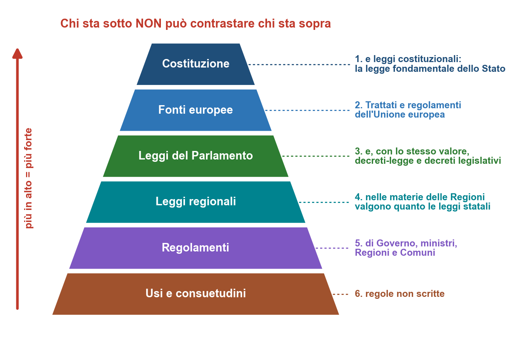

# Cap. 3 — Le fonti del diritto

Fonti: [P1.01 pp. 7–12] · dalla p. 7 («Le fonti del diritto») alla p. 12, fino a «Efficacia della legge nel tempo» (Cap. 4) · definizioni, schema e domande d'esame sono nel file di ripasso

> **Dove siamo** — Tappa I, *Le basi del diritto*, terzo capitolo. Sai che cos'è una norma (Cap. 1) e che cosa dà a ciascuno (Cap. 2). Ora: **chi può fare le norme, e quale vince** quando due norme dicono cose diverse?
>
> **Che cosa prepara:** il Cap. 4, su da quando una legge vale e come si interpreta.

## 3.1 Fonti di produzione e fonti di cognizione

> **Filo rosso** —
>
> **Cosa vediamo:** i due significati della parola «fonte».
>
> **Perché ci serve:** tutto il capitolo parla di fonti.
>
> **Perché è qui:** apre il tema; dal par. 3.2 si vedono le singole fonti.

> **Parole nuove** — **Fonte** = il punto da cui nasce qualcosa, come la sorgente di un fiume. **Gazzetta Ufficiale** = il giornale ufficiale dello Stato, dove si pubblicano le leggi. **Testo unico** = un solo testo che riunisce le norme su un argomento.

Il problema è capire **da dove nasce la norma giuridica**, che è diversa dalla regola morale e dai precetti religiosi (→ Cap. 1, par. 1.4). Le fonti si intendono in **due sensi** [P1.01 p. 7].

> **Definizione** — Le **fonti di produzione** sono gli strumenti e gli atti **da cui nasce** la norma giuridica, cioè da cui deriva il diritto [P1.01 p. 7].

> **Definizione** — Le **fonti di cognizione** sono gli strumenti con cui possiamo **conoscere e leggere** le norme già prodotte: il codice civile, una legge pubblicata sulla Gazzetta Ufficiale, una raccolta di leggi, un testo unico, un codice di altra natura come il **Codice del consumo** [P1.01 p. 7].

In breve: **produzione** = da dove **nasce** la norma; **cognizione** = dove la **leggo**. ==Per lo studio delle fonti interessa soprattutto capire da dove nasce la norma==: il capitolo parla quindi delle **fonti di produzione** [P1.01 p. 7].

> **Esempio aggiuntivo (tutor)** — Giulia cerca i diritti di chi compra online: la regola nasce da un atto del legislatore (**fonte di produzione**), e lei la legge nel Codice del consumo (**fonte di cognizione**).

## 3.2 Dall'art. 1 delle preleggi (1942) a oggi

> **Filo rosso** —
>
> **Cosa vediamo:** l'elenco delle fonti del 1942 e le novità arrivate dopo.
>
> **Perché ci serve:** spiega perché oggi le fonti sono sei, messe in ordine.
>
> **Perché è qui:** il par. 3.3 trasforma l'elenco in una piramide.

> **Parole nuove** — **Preleggi** (o «disposizioni preliminari») = le regole sulla legge in generale, scritte prima degli articoli del codice civile. **Autonomia regionale** = il potere delle Regioni di fare leggi proprie (par. 3.10).

> **Art. 1 disp. prel. c.c.** — Nella formulazione originaria del codice del 1942, secondo la lezione, indicava come fonti del diritto: **legge, regolamenti, usi, consuetudini** [P1.01 p. 7].

> **⚠ Da verificare** — Il codice dice: «le leggi; i regolamenti; le norme corporative; gli usi». Le **norme corporative**, del periodo fascista, sono state soppresse nel 1943; il codice parla solo di «usi». All'esame vale l'elenco del professore (punti_da_verificare.md, n. 28).

Dal 1942 l'elenco è stato integrato [P1.01 pp. 7–8]:

```flusso
1942: l'art. 1 delle preleggi elenca legge, regolamenti, usi, consuetudini
1948: entra in vigore la Costituzione, la fonte più importante
1957: il Trattato di Roma crea la Comunità Economica Europea
Poi: l'autonomia regionale dà alle Regioni il potere di fare leggi
```

Per questo ==oggi le fonti si rappresentano con una struttura gerarchica== [P1.01 p. 8].

## 3.3 La gerarchia delle fonti: la piramide

> **Filo rosso** —
>
> **Cosa vediamo:** l'ordine delle fonti, dalla più forte alla più debole.
>
> **Perché ci serve:** se due norme si contraddicono, dice quale vince.
>
> **Perché è qui:** ordina l'elenco del par. 3.2; dal par. 3.4 si scende gradino per gradino.

> **Parole nuove** — **Gerarchia** = un ordine dal più importante al meno importante, come i gradi nell'esercito. **Fonte subordinata** = una fonte più in basso, che deve rispettare quelle sopra.

L'ordine del professore: **1.** Costituzione e leggi costituzionali → **2.** legge del Parlamento → **3.** fonti europee → **4.** leggi regionali → **5.** regolamenti → **6.** usi e consuetudini. È una **piramide**: ==le fonti più in basso non possono contrastare con quelle che stanno sopra== [P1.01 p. 8].

> **⚠ Da verificare** — Qui le fonti europee sono **sotto** la legge; nel par. 3.9 il professore le mette **sopra la legge ordinaria** [P1.01 pp. 8, 11]. Vale la seconda versione (Corte costituzionale, sentenza 170/1984, «Granital»): per questo, nella piramide, sono al secondo gradino (punti_da_verificare.md, n. 1).



## 3.4 La Costituzione e le leggi costituzionali

> **Filo rosso** —
>
> **Cosa vediamo:** la cima della piramide e le leggi che la possono cambiare.
>
> **Perché ci serve:** ogni altra norma deve rispettarla.
>
> **Perché è qui:** è la cima; i par. 3.5 e 3.6 spiegano come si approvano le leggi.

> **Definizione** — La **Costituzione** è la **legge fondamentale dello Stato** e contiene norme giuridiche [P1.01 p. 8].

Anche le **norme programmatiche**, che non danno per forza un comando diretto ma indicano un programma da realizzare (→ Cap. 1, par. 1.7), sono norme giuridiche e vanno rispettate dalle fonti subordinate. Quindi ==la legge del Parlamento non può essere contraria alla Costituzione, e a maggior ragione non possono esserlo i regolamenti o le leggi regionali== [P1.01 p. 8].

> **Definizione** — La **legge costituzionale** è una legge approvata dal Parlamento con un **procedimento particolare e più complesso** di quello ordinario; serve a **modificare o integrare** la Costituzione [P1.01 p. 8].

> **Esempio del professore** — La modifica degli articoli 9 e 41 [P1.01 p. 8]
>
> **Situazione:** si vuole che la Costituzione protegga anche l'ambiente.
>
> **Problema giuridico:** come si cambia la legge fondamentale dello Stato?
>
> **Norma o principio:** con una legge costituzionale.
>
> **Conseguenza:** negli **artt. 9 e 41** è entrata la **tutela dell'ambiente** e degli **interessi delle future generazioni**. L'**art. 41** stabilisce che ==l'attività economica e commerciale è libera, ma va esercitata nel rispetto della salute e dell'ambiente==.

Secondo i costituzionalisti, alcuni **principi** dei primi articoli **non si possono cambiare nemmeno con una legge costituzionale**: la **forma democratica della Repubblica** e il **principio di uguaglianza** [P1.01 p. 8].

> **Nota del tutor (fuori dalle lezioni)** — La riforma è la **legge costituzionale 11 febbraio 2022, n. 1**. L'art. 9 tutelava già dal 1948 «il paesaggio e il patrimonio storico e artistico della Nazione», ricchezze del turismo italiano. Sui principi intoccabili: l'art. 139 vieta di cambiare la **forma repubblicana**; la Corte costituzionale (sentenza 1146/1988) parla di «principi supremi» non modificabili nemmeno con leggi costituzionali. Fonte: Brocardi, [art. 9](https://www.brocardi.it/costituzione/principi-fondamentali/art9.html), [art. 41](https://www.brocardi.it/costituzione/parte-i/titolo-iii/art41.html) e [art. 139 Cost.](https://www.brocardi.it/costituzione/parte-ii/titolo-vi/sezione-ii/art139.html); [legge cost. 1/2022 (Regione Trentino-Alto Adige)](https://www.regione.taa.it/content/download/39348/3056805/file/LEGGE_COSTITUZIONALE_2022_N_1.pdf); [Corte costituzionale, sent. 1146/1988](https://www.cortecostituzionale.it/scheda-pronuncia/1988/1146), verificata il 10/11/2026.

> **Esempio aggiuntivo (tutor)** — Marco vuole ampliare l'Hotel Bellavista, sul mare. Fare impresa è una sua libertà, ma deve rispettare salute e ambiente (art. 41): una legge può quindi limitare le costruzioni vicino alla spiaggia.

## 3.5 Come nasce una legge ordinaria

> **Filo rosso** —
>
> **Cosa vediamo:** il percorso di una legge, dalla proposta alla Gazzetta Ufficiale.
>
> **Perché ci serve:** per capire il procedimento «aggravato» bisogna prima conoscere quello normale.
>
> **Perché è qui:** prepara il par. 3.6 (è il motivo dato dal professore).

> **Parole nuove** — **Disegno** (o **proposta**) **di legge** = il testo di una legge non ancora approvata. **Commissione parlamentare** = un piccolo gruppo di parlamentari che si occupa di una materia. **Aula** = l'assemblea di tutti i deputati, o di tutti i senatori.

Il **Parlamento** ha **due Camere**: la **Camera dei Deputati** e il **Senato della Repubblica**. È un **bicameralismo perfetto**: ==le due Camere svolgono sostanzialmente le stesse funzioni== [P1.01 pp. 8–9].

```flusso
1. Iniziativa: propongono la legge i parlamentari, spesso il Governo, o i cittadini con le firme richieste (iniziativa popolare)
2. Commissione: esamina e discute il testo, può modificarlo, lo prepara per l'Aula
3. Prima Camera: l'Aula discute e vota
```

```flusso
4. Seconda Camera: deve approvare lo stesso identico testo; se lo cambia, torna all'altra Camera
5. Presidente della Repubblica: firma, oppure rinvia; se il Parlamento riapprova il testo, deve firmare
6. Gazzetta Ufficiale: la legge è pubblicata e, di solito dopo 15 giorni, diventa efficace
```

[P1.01 pp. 8–9]

## 3.6 La legge costituzionale e il procedimento aggravato

> **Filo rosso** —
>
> **Cosa vediamo:** perché cambiare la Costituzione è più difficile.
>
> **Perché ci serve:** spiega perché la Costituzione resta stabile.
>
> **Perché è qui:** completa il par. 3.5; il par. 3.7 mostra chi la difende.

> **Parole nuove** — **Procedimento aggravato** = un percorso più lungo e difficile. **Maggioranza** = i voti necessari per approvare; **due terzi** = 2 voti su 3. **Statuto** = la legge che organizza una Regione.

La legge costituzionale richiede un **procedimento aggravato**: Camera e Senato la approvano e poi la **riapprovano dopo un certo intervallo di tempo**, con una **maggioranza più alta**, fino ai **due terzi** nei casi previsti. Il motivo: ==la Costituzione è la legge fondamentale e non può essere cambiata facilmente da una maggioranza del momento== [P1.01 p. 9].

| | Legge ordinaria | Legge costituzionale |
|---|---|---|
| Serve a | fare le regole di ogni giorno | modificare o integrare la Costituzione |
| Approvazioni | una per Camera | due per Camera, a distanza di tempo |
| Maggioranza | normale | più alta, fino ai due terzi |

Sono leggi costituzionali anche gli **statuti delle cinque Regioni a statuto speciale**: **Valle d'Aosta, Trentino-Alto Adige, Friuli Venezia Giulia, Sicilia, Sardegna**. Per cambiarli serve una legge costituzionale [P1.01 p. 9].

> **Nota del tutor (fuori dalle lezioni)** — I numeri che il professore non dice, dalla Costituzione:
>
> - **legge ordinaria:** l'iniziativa popolare richiede **50.000 elettori** (art. 71); il Presidente firma (**promulga**) entro un mese e la legge entra in vigore il **quindicesimo giorno** dopo la pubblicazione, salvo un termine diverso (art. 73); il rinvio si fa con un **messaggio motivato** (art. 74);
> - **legge costituzionale:** due votazioni per Camera a distanza di **almeno tre mesi**; nella seconda serve la **maggioranza assoluta** (più della metà dei componenti); senza i due terzi si può chiedere un **referendum**, cioè il voto di tutti i cittadini (art. 138).
>
> Fonte: Brocardi, artt. [71](https://www.brocardi.it/costituzione/parte-ii/titolo-i/sezione-ii/art71.html), [73](https://www.brocardi.it/costituzione/parte-ii/titolo-i/sezione-ii/art73.html), [74](https://www.brocardi.it/costituzione/parte-ii/titolo-i/sezione-ii/art74.html) e [138 Cost.](https://www.brocardi.it/costituzione/parte-ii/titolo-vi/sezione-ii/art138.html); Studio Cataldi, [art. 71](https://www.studiocataldi.it/guide_legali/la-costituzione-italiana-commentata/art-71-costituzione) e [art. 74](https://www.studiocataldi.it/guide_legali/la-costituzione-italiana-commentata/art-74-costituzione); [Filodiritto, art. 138](https://www.filodiritto.com/codici/costituzione-della-repubblica-italiana/garanzie-costituzionali/art-138), verificata il 10/11/2026.

## 3.7 La Corte costituzionale

> **Filo rosso** —
>
> **Cosa vediamo:** chi controlla che le leggi rispettino la Costituzione.
>
> **Perché ci serve:** senza controllo, la piramide sarebbe solo una promessa.
>
> **Perché è qui:** dopo la Costituzione, il suo «guardiano».

> **Parole nuove** — **Questione di costituzionalità** = il dubbio che una norma sia contraria alla Costituzione. **Sospendere** = fermare per un po'. **Abrogazione** = togliere una norma dall'ordinamento giuridico.

> **Definizione** — La **Corte costituzionale** è il **giudice delle leggi**: valuta la **legittimità costituzionale** delle norme, cioè controlla che non siano contrarie alla Costituzione [P1.01 p. 9].

```flusso
Processo: è in corso un processo civile, penale o amministrativo
Dubbio: una parte, o il giudice da solo, pensa che la norma da applicare sia contraria alla Costituzione
Sospensione: il processo si ferma e la questione va alla Corte
Decisione: se la norma è incostituzionale, viene eliminata dall'ordinamento
```

==La norma dichiarata incostituzionale non potrà più essere usata per quella fattispecie==: per questo la decisione è determinante per il processo sospeso [P1.01 p. 9].

> **⚠ Da verificare** — Negli appunti questa frase è spezzata da un errore di impaginazione, che vi ha inserito la definizione di **abrogazione**. Il senso: la norma viene eliminata; l'art. 136 Cost. dice che «cessa di avere efficacia dal giorno successivo alla pubblicazione della decisione». Differenza con l'abrogazione: Cap. 4 (punti_da_verificare.md, nn. 6 e 17).
## 3.8 Parlamento e Governo: legge, decreto-legge, decreto legislativo

> **Filo rosso** —
>
> **Cosa vediamo:** chi fa le leggi e come anche il Governo fa norme con valore di legge.
>
> **Perché ci serve:** molte regole del diritto commerciale sono decreti del Governo.
>
> **Perché è qui:** è il gradino delle leggi; il par. 3.9 passa all'Europa.

> **Parole nuove** — **Funzione legislativa** = fare le leggi. **Funzione esecutiva** = governare lo Stato. **Convertire** un decreto = trasformarlo in legge. **Decadere** = perdere effetto. **Legge delega** = la legge con cui il Parlamento affida al Governo il compito di scrivere una disciplina.

Gli organi più importanti dello Stato sono **Parlamento, Governo e Presidente della Repubblica**; la **magistratura** ha la **funzione giudicante** (→ Cap. 1, par. 1.10). Il **Parlamento** ha la **funzione legislativa**, il **Governo** quella **esecutiva** [P1.01 p. 9].

Le leggi spettano al Parlamento per il suo **carattere rappresentativo**: ==i cittadini votano i propri rappresentanti, che approvano le regole valide anche per loro==. Il Governo ha una **rappresentanza indiretta**, perché nasce dal rapporto con il Parlamento; può però fare norme con valore di legge con **due strumenti** [P1.01 p. 10].

> **Definizione** — Il **decreto-legge** è una norma del Governo per situazioni di **necessità e urgenza**: è **efficace subito**, dalla pubblicazione, ma il Parlamento deve **convertirlo in legge entro 60 giorni**; se no, **decade** [P1.01 p. 10].

Permette di intervenire in fretta, sotto il controllo del Parlamento: la **conversione** rende stabile la disciplina. Ma proprio perché produce effetti subito, ==usarlo fuori dai casi di necessità e urgenza è un problema==; eppure negli ultimi decenni i Governi lo hanno usato spesso [P1.01 p. 10].

> **Definizione** — Nel **decreto legislativo** il rapporto si inverte: il **Parlamento delega il Governo** con una **legge delega**, che fissa **principi e criteri**; il Governo scrive in concreto il testo. Si usa per **riforme importanti e tecniche** [P1.01 p. 10].

> **Esempio del professore** — La riforma delle società quotate [P1.01 p. 10]
>
> **Situazione:** si vuole **rendere il mercato italiano più attraente per gli investitori esteri** e facilitare la quotazione in borsa.
>
> **Problema giuridico:** servono regole molto tecniche. Chi le scrive?
>
> **Norma o principio:** il Parlamento approva una legge delega con questo obiettivo; il Governo nomina una **commissione di esperti**, di solito professori di diritto commerciale.
>
> **Conseguenza:** sul lavoro degli esperti il Governo prepara il **decreto legislativo**. Così sono nate anche le riforme del **2003** e del **2009**, quest'ultima collegata al **Codice della crisi e dell'insolvenza**.

> **⚠ Da verificare** — Il Codice della crisi d'impresa e dell'insolvenza è del **2019** (D.Lgs. 14/2019): «2009» è un refuso. La riforma del 2003 è il D.Lgs. 6/2003 sulle società di capitali. Entrambe seguono il meccanismo spiegato dal professore (punti_da_verificare.md, n. 9).

La legge approvata dal Parlamento è la **legge in senso formale**; decreto-legge e decreto legislativo sono **leggi in senso sostanziale**, perché hanno **valore di legge ordinaria** anche se seguono procedimenti diversi [P1.01 p. 10].

| | Legge | Decreto-legge | Decreto legislativo |
|---|---|---|---|
| Chi la scrive | il Parlamento | il Governo | il Governo |
| Il Parlamento… | la approva | lo converte entro 60 giorni, se no decade | prima dà la delega |
| Quando | sempre | necessità e urgenza | riforme importanti e tecniche |
| Legge in senso… | formale | sostanziale | sostanziale |

> **Nota del tutor (fuori dalle lezioni)** — Artt. 76 e 77 Cost.: la delega va data con «principi e criteri direttivi», per un **tempo limitato** e su **oggetti definiti**; il decreto-legge non convertito perde efficacia **sin dall'inizio**, come se non fosse mai esistito. Fonte: Brocardi, [art. 76](https://brocardi.it/costituzione/parte-ii/titolo-i/sezione-ii/art76.html) e [art. 77 Cost.](https://www.brocardi.it/costituzione/parte-ii/titolo-i/sezione-ii/art77.html); [Studio Cataldi, art. 77](https://www.studiocataldi.it/guide_legali/la-costituzione-italiana-commentata/art-77-costituzione), verificata il 10/11/2026.

> **Trappola d'esame** — **Decreto-legge**: il Governo agisce **prima**, il Parlamento controlla **dopo**. **Decreto legislativo**: il Parlamento decide **prima** (legge delega), il Governo scrive **dopo**.

## 3.9 Le fonti europee

> **Filo rosso** —
>
> **Cosa vediamo:** perché le regole europee valgono in Italia e quanto pesano.
>
> **Perché ci serve:** turismo e commercio internazionale sono pieni di regole europee.
>
> **Perché è qui:** è il gradino tra Costituzione e leggi; il par. 3.10 scende alle Regioni.

> **Parole nuove** — **Trattato** = un accordo scritto tra Stati. **Ratifica** = l'atto con cui uno Stato approva un trattato. **Disapplicare** = non applicare una norma a un caso, senza cancellarla. **Dazio** = una tassa sulle merci che passano un confine. **Recepire** = trasformare una direttiva in legge nazionale.

Perché norme **non approvate dal legislatore italiano** valgono in Italia [P1.01 p. 10]?

> **Art. 11 Cost.** — Secondo la lezione, consente allo Stato di stipulare convenzioni internazionali e, con la **ratifica**, di **assoggettarsi alle loro regole** [P1.01 p. 11].

**Trattato di Roma** (1957) → Comunità Economica Europea; **Trattato di Maastricht** (1992) → Unione Europea; **Trattato di Lisbona** (2007), sul funzionamento dell'Unione. Così ==l'Italia ha accettato che alcune regole siano prodotte a livello europeo== [P1.01 p. 11].

Le fonti europee stanno ==sotto la Costituzione, ma sopra la legge ordinaria==: se una norma europea conforme alla Costituzione contrasta con una legge italiana, ==il giudice disapplica la norma italiana e applica quella europea== [P1.01 p. 11].

Il **Trattato** contiene principi e regole concrete: **tutela della concorrenza**, **libera circolazione delle persone e dei lavoratori**, **libertà di stabilimento delle imprese** (aprire una sede in un altro Stato). L'Unione nasce come **mercato allargato**, per superare **barriere e dazi** tra i Paesi; poi si estende alla libera circolazione delle persone [P1.01 p. 11].

L'Unione usa soprattutto **due strumenti** (→ Cap. 1, par. 1.1):

| | Regolamento europeo | Direttiva |
|---|---|---|
| Come vale in Italia | **subito**, in tutti gli Stati, senza una legge nazionale | solo dopo essere stata **recepita** con una legge |

==Valgono direttamente come fonti del diritto il Trattato e i regolamenti==; la direttiva ha bisogno del recepimento [P1.01 p. 11].

> **Esempio aggiuntivo (tutor)** — Elena spedisce vasi a Vienna senza **dazi**. Se il volo di Hans è cancellato vale un **regolamento**, uguale in tutta l'Unione; il suo pacchetto vacanze segue una **direttiva**, recepita dall'Italia con un decreto legislativo (Note del Cap. 1, par. 1.1).

## 3.10 Le leggi regionali

> **Filo rosso** —
>
> **Cosa vediamo:** su quali materie fanno leggi le Regioni.
>
> **Perché ci serve:** il **turismo** è una materia delle Regioni.
>
> **Perché è qui:** è il quarto gradino; il par. 3.11 scende ai regolamenti.

> **Parole nuove** — **Competenza** = l'insieme delle materie su cui un ente può fare leggi. **Concorrente** = condivisa tra Stato e Regioni.

La Costituzione permette alle **Regioni** di fare norme giuridiche in **determinate materie** [P1.01 p. 11]:

| Competenza | Chi fa le leggi | Esempi del professore |
|---|---|---|
| **esclusiva dello Stato** | solo lo Stato | il diritto penale |
| **regionale** | le Regioni, con **valore equivalente alle leggi statali** | artigianato, agricoltura, **turismo** |
| **concorrente** | Stato e Regioni insieme | qui nascono i conflitti di competenza |

==Il turismo è materia di competenza regionale==. I **conflitti tra lo Stato e gli enti territoriali** (come le Regioni) li risolve la **Corte costituzionale** [P1.01 p. 11].

> **Trappola d'esame** — Nella piramide le leggi regionali stanno sotto la legge del Parlamento, ma ==nelle materie regionali valgono quanto le leggi statali== [P1.01 pp. 8, 11]. Tra Stato e Regioni conta la **materia**.

> **Nota del tutor (fuori dalle lezioni)** — Le materie sono nell'art. 117 Cost. (riscritto nel 2001). Allo Stato spetta l'«ordinamento civile e penale»: anche il **diritto privato** di questo corso è dello Stato. Alle Regioni spetta ogni materia «non espressamente riservata» allo Stato, come il **turismo**: per questo la Corte costituzionale (sentenza 80/2012) ha annullato parti del **Codice del turismo** (D.Lgs. 79/2011), che invadevano la competenza regionale. Fonte: [Brocardi, art. 117 Cost.](https://www.brocardi.it/costituzione/parte-ii/titolo-v/art117.html); [Studio Cataldi, art. 117](https://www.studiocataldi.it/guide_legali/la-costituzione-italiana-commentata/art-117-costituzione); [Corte costituzionale, sent. 80/2012](https://www.cortecostituzionale.it/scheda-pronuncia/2012/80), verificata il 10/11/2026.

> **Esempio aggiuntivo (tutor)** — Giulia, a Rimini, segue le leggi dell'Emilia-Romagna sul turismo; in Toscana troverebbe leggi toscane, forse diverse. Il contratto con Hans segue invece il diritto privato, uguale in tutta Italia.

## 3.11 I regolamenti

> **Filo rosso** —
>
> **Cosa vediamo:** i regolamenti di Governo, ministri, Regioni e Comuni.
>
> **Perché ci serve:** sono le regole più vicine alla vita di ogni giorno.
>
> **Perché è qui:** è il quinto gradino; il par. 3.12 chiude con la base.

> **Parole nuove** — **Atto amministrativo** = una decisione della pubblica amministrazione. **DM** = decreto ministeriale. **DPCM** = decreto del Presidente del Consiglio dei Ministri.

==Questi regolamenti non vanno confusi con i regolamenti dell'Unione europea== [P1.01 p. 11]. Sono **atti amministrativi**, soprattutto del **Governo** e dei **ministri**: i ministri emanano **decreti ministeriali (DM)** nelle loro competenze, e ci sono i **DPCM**. Sono **fonti subordinate**: non possono contrastare con la legge e, a maggior ragione, con la Costituzione [P1.01 p. 12].

| | Regolamento europeo | Regolamento nazionale |
|---|---|---|
| Chi lo fa | l'Unione europea | Governo, ministri, Regioni, Comuni |
| Che cos'è | una fonte europea | un atto amministrativo |
| Davanti alla legge italiana | **prevale** | **non può contrastarla** |

> **Esempio del professore** — I regolamenti del Comune [P1.01 p. 12]
>
> **Situazione:** il cimitero va organizzato; alberi ed edifici vanno tenuti a distanza.
>
> **Problema giuridico:** chi detta queste regole locali?
>
> **Norma o principio:** i regolamenti possono essere anche **regionali o comunali**.
>
> **Conseguenza:** il Comune emana un regolamento sull'attività cimiteriale (o su altri aspetti della vita comunale); le **distanze tra alberi ed edifici** sono regolate dalla normativa generale e anche dai regolamenti comunali.

## 3.12 Usi e consuetudini

> **Filo rosso** —
>
> **Cosa vediamo:** le regole non scritte, alla base della piramide.
>
> **Perché ci serve:** riempiono i vuoti delle leggi, e il diritto commerciale è nato così.
>
> **Perché è qui:** è l'ultimo gradino; il Cap. 4 spiega da quando una legge vale.

> **Parole nuove** — **Collettività** = un gruppo di persone. **Vuoto** = una situazione che nessuna norma regola. **Diffida** = un avvertimento formale. **Adempiere** = fare ciò che si deve (→ Cap. 10). **Risolto** = sciolto (→ Cap. 19). **Congruo** = adeguato.

> **Definizione** — La **consuetudine** è una fonte del diritto che nasce da un **comportamento seguito da una collettività**, con la **convinzione che quel comportamento sia una regola**. È una regola **non necessariamente scritta** [P1.01 p. 12].

In breve: **comportamento ripetuto + convinzione di doverlo seguire → consuetudine**.

Le consuetudini ==non possono contrastare con le leggi o con i regolamenti==. Servono soprattutto quando c'è un **vuoto nell'ordinamento**: per risolvere una controversia si guarda allora a usi e consuetudini. E il codice civile **richiama espressamente gli usi** in alcune norme [P1.01 p. 12].

> **Art. 1454 c.c.** — La **diffida ad adempiere**, secondo la lezione: se una parte non adempie a un contratto, l'altra può **intimarle per iscritto** di adempiere entro un termine, avvertendo che, se il termine passa inutilmente, il contratto si intenderà **risolto**. Il termine non può essere **inferiore a 15 giorni**, salvo diverso accordo delle parti o salvo che, per la natura del contratto, **secondo gli usi** sia congruo un termine minore [P1.01 p. 12].

> **Esempio del professore** — Gli usi nella diffida ad adempiere [P1.01 p. 12]
>
> **Situazione:** in un contratto, una parte non fa ciò che deve.
>
> **Problema giuridico:** quanto tempo le si deve dare prima di sciogliere il contratto?
>
> **Norma o principio:** l'art. 1454 fissa almeno 15 giorni, ma richiama gli usi.
>
> **Conseguenza:** se per quel contratto gli usi considerano adeguato un termine più breve, basta quello: è la legge stessa a rinviare alla consuetudine.

> **⚠ Da verificare** — Qui negli appunti compare per errore una frase sull'efficacia della legge dopo 15 giorni: appartiene al Cap. 4 (punti_da_verificare.md, n. 7).

Infine, ==il diritto commerciale nasce come diritto consuetudinario==: **mercanti** e mercati creavano regole proprie, non scritte in un codice ma nate da comportamenti ripetuti e considerati vincolanti; solo dopo sono state regolate e inserite nell'ordinamento [P1.01 p. 12].

> **Nota del tutor (fuori dalle lezioni)** — Nelle materie regolate da leggi e regolamenti, gli usi valgono solo se richiamati (art. 8 preleggi), come nell'art. 1454. Gli usi pubblicati nelle raccolte ufficiali si presumono esistenti fino a prova contraria (art. 9): li raccolgono le **Camere di commercio**, provincia per provincia. Nelle raccolte di Trento e di Cosenza, per esempio, la camera d'albergo va lasciata **entro le 12 del giorno di partenza** (entro le 10 nelle località di villeggiatura). Nel commercio internazionale, gli usi dei mercanti sono raccolti negli **Incoterms** della Camera di commercio internazionale, che valgono se il contratto li richiama. Fonte: Brocardi, [art. 8](https://www.brocardi.it/preleggi/capo-i/art8.html) e [art. 9 disp. prel.](https://www.brocardi.it/preleggi/capo-i/art9.html); [Camera di commercio di Trento, Raccolta degli usi 2009](https://www.tn.camcom.it/sites/default/files/uploads/documents/UsiEConsuetudini/RaccoltaProvincialeUsi2009.pdf) (usi alberghieri, art. 2); [Camera di commercio di Cosenza, usi nel turismo](https://www.cs.camcom.it//sites/default/files/TURISMO%20-%20ALTRI%20USI.pdf) (art. II); sugli Incoterms [Dequo](https://www.dequo.it/articoli/incoterms) e [ICC](https://library.iccwbo.org/content/clp/books/BK_0057/clp-805e.htm), verificata il 10/11/2026.

> **Esempio aggiuntivo (tutor)** — Hans, in vacanza in Trentino, lascia la camera alle 15 senza accordi: secondo l'uso raccolto a Trento, l'albergatore può fargli pagare la stanza. Elena usa gli Incoterms nei contratti con l'estero: è chiaro chi paga il trasporto e chi rischia se i vasi si rompono.

> **Verso il prossimo capitolo** — Ora sai **chi fa le norme** e **quale prevale**. Il **Cap. 4** spiega **da quando** una legge vale (pubblicazione e 15 giorni di attesa), come smette di valere (**abrogazione**) e come si **interpreta**. È l'ultimo passo della Tappa I.
